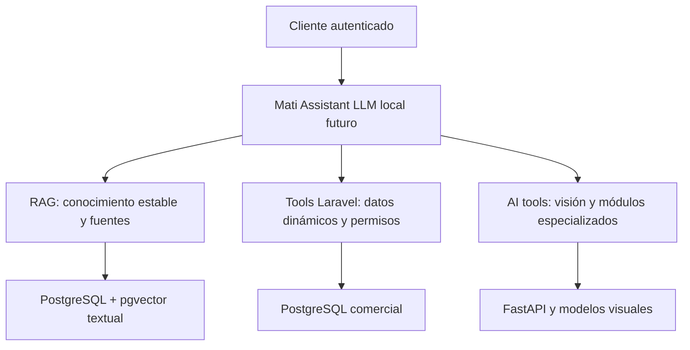

# Limitaciones y siguiente fase

La fundación termina en recuperar contexto estable con procedencia. No se implementa generación conversacional, selector entrenado, recomendaciones, outfits ni actualización de pesos. Las definiciones extendidas y la relevancia del benchmark son una propuesta pequeña de Codex pendiente de revisión del dominio Mati; los IDs y nombres se contrastan con PostgreSQL, pero esa validación no convierte las reglas visuales en ground truth humano.

## Autoridad y separación

PostgreSQL comercial conserva autoridad sobre categorías activas, productos, variantes, precios, stock, reservas, pagos e inventario. La taxonomía versionada conserva semántica extendida revisable. SigLIP conserva clasificación y embeddings visuales en su espacio propio. Los nuevos embeddings textuales usan identidad modelo/revisión/dimensión/preprocesamiento/normalización explícita y tablas RAG separadas, aunque un candidato tenga las mismas 768 dimensiones que SigLIP.

El corpus curado contiene sólo conocimiento relativamente estable. Una referencia de producto describe conceptos; no representa disponibilidad o precio actual. El texto recuperado se trata como datos. No ejecuta acciones, no construye SQL y no permite ingestión desde paths elegidos por una petición. La consulta usa parámetros y filtros acotados. Cosine similarity es una similitud sin calibrar; no es probabilidad ni porcentaje de corrección.

## Arquitectura futura, no implementada

| Consulta | Ruta futura y autoridad |
|---|---|
| ¿Qué es una blusa? | RAG, definición versionada y cita. |
| ¿Quedan blusas talla M? | Tool Laravel/DB, stock vigente y permisos. |
| ¿Cuánto cuesta? | Tool Laravel/DB, precio vigente. |
| ¿Cuál combina con este pantalón? | Futuro módulo de compatibilidad/outfits, pendiente de otro diseño y validación. |
| ¿Qué aparece en esta foto? | AI tool visual; RAG puede aportar contexto explicativo separado. |

La fase actual no implementa el LLM ni esos tools futuros. Las preguntas dinámicas se rechazan con insuficiencia de evidencia y señal de tool requerido. El corpus no suplanta autorización comercial ni debe usarse como clasificación de imagen o como ranker de regiones en tiempo real.

## Experimento futuro de prompts visuales

Otro benchmark deberá comparar prompts SigLIP actuales contra prompts derivados de una versión revisada de la taxonomía. Congelar imágenes, etiquetas humanas independientes, prompts, agregación y gate antes de medir; comparar confusiones CAMISAS/BLUSAS, BLAZERS/ABRIGOS, POLERA/POLOS Y KNITWEAR y VESTIDOS/CONJUNTOS. No modificar en esta fase modelo, revisión, prompts, thresholds, vectores canónicos ni decisiones classification FULL / embedding FULL / color NONE. AUD-07 continúa mitigado operacionalmente, no resuelto visualmente.

## Límites de evidencia

El corpus y las consultas congeladas son pequeños. Las métricas sirven para este conjunto, no para inferir cobertura general del catálogo o significancia estadística amplia. Una regla de abstención por similitud tiene errores fuera de distribución; no garantiza rechazo de cualquier pregunta desconocida. Las pruebas negativas y de aislamiento no sustituyen revisión del dominio ni evaluación futura de consultas reales independientes.

POLERA conserva descripción/grupo de talla comercial nulos; CONJUNTOS conserva su grupo comercial ALFA/SUPERIOR y recibe rol conceptual MULTI_PIECE. La imagen13 conserva su categoría comercial ABRIGOS; la observación de una región superior semejante a tejido de punto no habilita relabel automático, entrenamiento ni ground truth retrospectivo. Revisar estas ambigüedades con Mati antes de promover semántica como política de negocio.

## Aprendizaje humano futuro

El circuito futuro es DINO/SAM → snapshot de candidatos → elección humana explícita → eventos idempotentes → dataset versionado por grupo → train/validation/holdout → gate → nueva versión. El contrato se valida ahora; no se captura ninguna decisión productiva ni existe dataset entrenable. El manifest tiene cero eventos. Las precondiciones P2 de duplicados, foto A/B, SHA, respuesta stale, persistencia atómica y lineage siguen abiertas y se detallan en el documento06. La categoría final posterior queda fuera de las features previas, y copias de una imagen nunca deben cruzar train/test.

Active learning deberá dirigir casos ambiguos al humano y validar confianza/margen con datos independientes antes de automatizar. No se fija ahora threshold final del ranker. No se actualizan pesos por clic. Logistic Regression, boosting, rankers o MLP son alternativas posteriores; no se instalaron ni entrenaron aquí.

## Condiciones de revisión

Los documentos03 y05 registran los resultados reales: el modelo textual E5-small pasó; el RAG falló abstención (9/16=56,25%,frente al90% exigido) y la búsqueda pública queda bloqueada con retrieval_approved=false. Si no hay candidato elegible, winner=NONE; si falla el gate RAG, no se declara funcional ni se reajustan los umbrales con las mismas consultas. Cambios posteriores requieren corpus/evaluación/perfil con nueva identidad y una revisión separada. Los pesos públicos permanecen en caché local, las evidencias numéricas en storage privado y los artefactos revisables en el repositorio. No se ejecuta git add, commit ni push.
