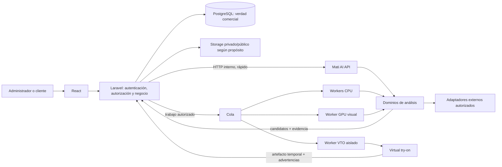
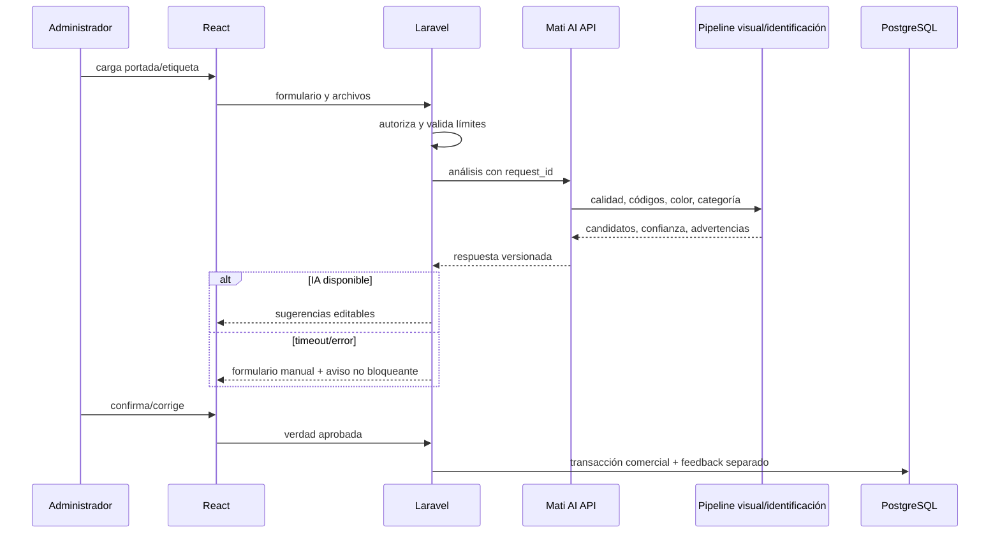
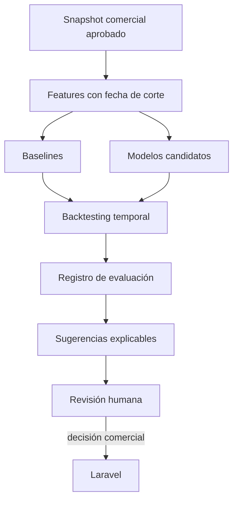

# Arquitectura modular V2

**Estado:** arquitectura objetivo; no implementada  
**Fecha de consulta y diseño:** 2026-08-03

## 1. Decisión arquitectónica

V2 conserva un solo límite de confianza comercial y distribuye el procesamiento inteligente por dominios. Laravel sigue siendo el sistema de registro; FastAPI es un plano de inferencia y cálculo sin autoridad comercial. Los trabajos rápidos usan HTTP interno. Los trabajos con fuentes externas, lotes, pronóstico o generación usan una cola controlada por Laravel y workers especializados.



Regla invariante: ningún worker confirma una compra, modifica stock, crea una marca/talla, publica una imagen externa o convierte una predicción en dato comercial.

## 2. Dominios y responsabilidades

| Dominio | Responsabilidad | No hace |
|---|---|---|
| `vision` | validar, medir calidad, extraer color/atributos, embedding y candidatos | confirmar categoría o editar el original |
| `identification` | leer/normalizar código, QR y etiqueta; reconciliar identificadores | asumir que un código contiene toda la ficha |
| `enrichment` | consultar fuentes, normalizar candidatos, comparar y preparar propuestas | publicar ni apropiarse de imágenes externas |
| `trends` | ingerir señales permitidas y calcular evidencia externa | convertir popularidad en orden de compra |
| `commercial` | indicadores, patrones, forecast, reposición, surtido y anomalías | escribir ventas, Kardex o pedidos |
| `recommendations` | generar candidatos y rankear similares, cross-sell, outfits y perfil | ocultar productos sin registrar exposición |
| `publication` | producir derivados reproducibles a partir de un activo aprobado | alterar color/diseño sin advertencia y aprobación |
| `virtual_try_on` | generar visualización sintética asíncrona | afirmar talla o ajuste |
| `sizing` | aplicar tablas, medidas, historial y reglas de ajuste | inferir medidas fiables de una foto |
| `rag` | recuperar corpus autorizado y responder con citas/herramientas limitadas | ejecutar mutaciones comerciales de forma autónoma |

## 3. Capas comunes

### 3.1 API

- Validación de schemas y límites de carga.
- Autenticación servicio-a-servicio, correlación y versionado.
- Idempotencia, deadlines y códigos de error estables.
- No contiene lógica de modelos ni acceso a HTML de terceros.

### 3.2 Orquestación de casos de uso

- Compone pasos de uno o más dominios.
- Aplica políticas de timeout, fallback y abstención.
- Selecciona modelo mediante un registro; no importa checkpoints desde el endpoint.
- Produce un sobre de respuesta uniforme.

### 3.3 Dominio

- Algoritmos, interfaces y reglas puras cuando sea posible.
- No conoce Laravel, React, ORM comercial ni credenciales.
- Distingue entrada, observación, candidato, predicción y confirmación.

### 3.4 Infraestructura

- Carga de modelos y dispositivos.
- Clientes HTTP, storage temporal, cache y adaptadores de fuentes.
- Métricas, logs y trazas sin datos personales innecesarios.
- Implementa interfaces del dominio y puede sustituirse.

## 4. Estructura de carpetas propuesta

La siguiente estructura es conceptual. No se debe crear completa al inicio. Cada carpeta aparece solo cuando una fase entrega una implementación real.

```text
services/mati-ai/src/mati_ai/
├── app.py
├── api/
│   ├── dependencies.py
│   ├── errors.py
│   └── v1/
├── core/
│   ├── config.py
│   ├── security.py
│   ├── observability.py
│   ├── idempotency.py
│   ├── model_registry.py
│   └── policies.py
├── contracts/
│   ├── common.py
│   ├── vision.py
│   ├── identification.py
│   ├── commercial.py
│   └── recommendations.py
├── vision/
│   ├── pipeline.py
│   ├── validation.py
│   ├── quality.py
│   ├── color.py
│   ├── classification.py
│   ├── attributes.py
│   ├── segmentation.py
│   └── embeddings.py
├── identification/
│   ├── pipeline.py
│   ├── codes.py
│   ├── ocr.py
│   ├── normalization.py
│   └── matching.py
├── enrichment/
│   ├── service.py
│   ├── ports.py
│   ├── ranking.py
│   ├── safe_fetch.py
│   └── adapters/
├── publication/
│   ├── pipeline.py
│   └── derivatives.py
├── trends/
│   ├── service.py
│   ├── ports.py
│   ├── scoring.py
│   └── adapters/
├── commercial/
│   ├── analytics.py
│   ├── association.py
│   ├── forecasting.py
│   ├── replenishment.py
│   ├── assortment.py
│   └── anomalies.py
├── recommendations/
│   ├── candidates.py
│   ├── profiles.py
│   ├── cross_sell.py
│   ├── outfits.py
│   └── ranking.py
├── virtual_try_on/
│   ├── contracts.py
│   ├── preprocessing.py
│   ├── pipeline.py
│   └── privacy.py
├── sizing/
│   ├── rules.py
│   ├── profiles.py
│   └── ranking.py
├── rag/
│   ├── retrieval.py
│   ├── tools.py
│   └── guardrails.py
└── workers/
    ├── cpu.py
    ├── gpu_vision.py
    └── virtual_try_on.py
```

### 4.1 Correcciones frente a la estructura sugerida

- `schemas` pasa a `contracts` para señalar que son interfaces externas versionadas, no modelos comerciales.
- Código de barras, QR y GTIN comparten `codes.py`; separarlos en carpetas desde el principio fragmentaría una misma normalización.
- `publication` es dominio propio porque transforma activos aprobados y tiene políticas diferentes de búsqueda externa.
- `commercial_intelligence` se acorta a `commercial`; sus submódulos siguen separados conceptualmente.
- Los adaptadores viven debajo del dominio que los usa y cumplen puertos comunes; no se expone HTML específico fuera de ellos.
- `workers` contiene puntos de entrada, no algoritmos duplicados.
- No se crea un paquete por cada técnica (`knn`, `kmeans`, `cnn`); las técnicas son implementaciones internas.

## 5. Flujos principales

### 5.1 Alta asistida de prenda — síncrono con fallback



Objetivo de latencia inicial: un análisis ligero debe tener deadline de segundos, no minutos. Si embedding/modelo no termina, calidad y reglas útiles pueden devolverse como respuesta parcial explícita.

### 5.2 Fuente externa — asíncrono o síncrono acotado

1. Laravel crea una solicitud autorizada e idempotente.
2. El worker construye consultas sin datos personales.
3. Cada adaptador aplica términos, límites, cache y política de derechos.
4. La descarga temporal pasa por controles SSRF, tipo real, tamaño y redirecciones.
5. Los candidatos se normalizan, deduplican y rankean.
6. Laravel persiste metadatos/evidencia; los binarios temporales expiran.
7. El administrador selecciona; publicar exige aprobación de derechos separada.

### 5.3 Inteligencia comercial — batch reproducible



La fecha de corte impide fuga de información. Una recomendación registra qué datos conocía el modelo en ese momento.

### 5.4 Virtual try-on — siempre asíncrono

Laravel valida consentimiento, categoría y activos; crea el job y entrega referencias opacas al worker. El worker VTO descarga desde storage privado mediante URL firmada corta, genera un artefacto temporal, lo marca como sintético, devuelve métricas técnicas y descarga la GPU. Laravel notifica y aplica la retención. El worker no recibe nombre, teléfono, correo, historial de compras ni medidas.

## 6. Sincronía, asincronía y responsable

| Operación | Modalidad recomendada | Timeout/estado | Persistencia |
|---|---|---|---|
| MIME, dimensiones, hash, calidad, color | Síncrona | deadline corto; parcial permitido | Laravel guarda predicción/confirmación |
| Barcode/QR en una imagen | Síncrona | deadline corto | Laravel |
| OCR de etiqueta | Síncrona acotada; batch opcional | timeout mayor que barcode | Laravel |
| Embedding y similares internos | Síncrona al inicio | exacto con catálogo pequeño | Laravel/índice aprobado |
| Búsqueda externa | Asíncrona preferida | `queued/running/completed/partial/failed/expired` | Laravel |
| Preparación de derivados | Asíncrona si son múltiples | idempotente por hash+perfil | Laravel/storage |
| Tendencias | Batch programado/manual | tolera fuente ausente | Laravel |
| Patrones/forecast/reposición/surtido | Batch | snapshot y fecha de corte | Laravel |
| Recomendaciones online simples | Síncrona | fallback popularidad | Laravel registra exposición |
| VTO | Asíncrona obligatoria | cola, progreso y expiración | Laravel/storage temporal |
| Talla por reglas | Síncrona | abstención si faltan datos | Laravel |
| Transfer learning | Offline separado | nunca en proceso web | Registro de modelos/artefactos |
| RAG | Síncrona con streaming opcional | citas o abstención | sesión y auditoría en Laravel |

## 7. Estrategia de cómputo para RTX 5060 de 8 GB

### 7.1 Clases de worker

- **API/CPU:** validación, hashing, calidad, color, normalización, reglas y respuestas.
- **CPU batch:** OCR base, reportes, reglas de asociación, backtesting y preparación de imágenes cuando sea aceptable.
- **GPU visual:** un proceso con SigLIP o el modelo visual aprobado; batch pequeño y carga controlada.
- **GPU VTO:** proceso separado, concurrencia uno, arranque bajo demanda y descarga total al finalizar.

### 7.2 Política de memoria

- Nunca cargar simultáneamente SigLIP/CLIP, detector, segmentador, OCR profundo y VTO.
- Un semáforo de GPU asigna exclusividad; la cola informa espera, no provoca OOM.
- Los modelos se fijan por nombre, revisión, hash, licencia y perfil de precisión.
- `fp16`/`bf16`, cuantización u offload se aceptan solo tras medir calidad, latencia y memoria en la máquina real.
- Ante OOM, el job falla de forma controlada, libera recursos y no reintenta indefinidamente.
- La API permanece saludable aunque el worker GPU se reinicie.

### 7.3 SLOs que deben medirse

- p50/p95 de latencia por pipeline y modelo;
- máximo de VRAM/RAM y tiempo de carga;
- tasa de timeout/OOM y profundidad de cola;
- costo por job externo/generativo;
- precisión o métrica de negocio, no solo velocidad;
- tiempo hasta fallback manual.

No se asigna un SLO numérico a VTO hasta ejecutar un benchmark autorizado en la RTX 5060; afirmarlo desde documentación sería especulativo.

## 8. Tipos de técnica por módulo

| Módulo | Tipo de IA/algoritmo | Modelo inicial | Evolución futura |
|---|---|---|---|
| Validación de archivo | Determinista | firma/MIME, límites, orientación | sandbox de decodificación |
| Calidad | Visión clásica/reglas | Laplaciano, histogramas, exposición | calibración supervisada |
| Color | Clustering/espacios de color | histogramas + K-Means controlado | segmentación de prenda |
| Categoría/atributos | Multimodal zero-shot | SigLIP; CLIP baseline | FashionSigLIP y transfer learning evaluado |
| Detección | Deep Learning supervisado | ninguno en MVP1 | detector con anotaciones propias |
| Segmentación | Visión/DL | heurísticas/fondo controlado | SAM2 asistido o modelo especializado |
| Identificación | Lectura 1D/2D + reglas | OpenCV + checksum | ZXing-C++; OCR fallback |
| OCR | OCR clásico/neural | Tesseract benchmark | EasyOCR/PaddleOCR/TrOCR según caso |
| Similares | Embedding + similitud coseno/KNN | búsqueda exacta | pgvector/Faiss al crecer |
| Patrones de compra | SQL + asociación | conteos/reglas curadas | FP-Growth con soporte suficiente |
| Demanda | Series temporales | naive/móvil/Croston según serie | ETS/ARIMA/boosting; deep solo con escala |
| Reposición | Investigación operativa/reglas | cobertura/min-max | stock de seguridad probabilístico/optimización |
| Surtido | Ranking multicriterio | score explicable | learning-to-rank con resultados históricos |
| Personalización | Recomendador híbrido | popularidad + contenido | colaborativo/LTR cuando haya eventos |
| Outfits | Reglas + ranking | matriz de compatibilidad | embeddings y señales de compra conjunta |
| VTO | Modelo generativo de difusión/transformación | ningún modelo aprobado aún | candidato comercial tras licencia+benchmark |
| Talla | Reglas/ranking | tabla por marca + medidas | probabilístico con feedback/devoluciones |
| RAG | Recuperación + modelo generativo | no priorizado | asistente con corpus/citas y tools de lectura |

## 9. Gestión de modelos y políticas

Cada modelo activable debe tener una ficha inmutable:

- `model_id`, versión/revisión y hash de artefactos;
- tarea, taxonomía y contrato compatibles;
- origen, licencia de código, licencia de pesos y restricciones de dataset;
- dispositivo, precisión, memoria y latencia medidas;
- datos de evaluación, métricas, umbrales y fecha;
- estado `candidate`, `shadow`, `active`, `retired` o `blocked`;
- propietario de aprobación y plan de rollback.

El registro no descarga modelos en runtime productivo. Un cambio de modelo es una liberación auditada, no una consecuencia automática de actualizar una librería.

## 10. Seguridad y privacidad transversales

- Identidad de servicio, rotación de token, allowlist de red y TLS donde corresponda.
- Archivos decodificados en un proceso limitado; no confiar en extensión ni `Content-Type` del cliente.
- URLs externas pasan por allowlist, resolución y validación de IP, límites de redirección, tamaño, tiempo y tipo; se bloquean rangos privados, loopback, link-local y metadatos cloud.
- Se elimina EXIF de derivados; el original privado conserva solo lo aprobado por política.
- Logs usan `request_id`, hashes y códigos; no imágenes, tokens, medidas ni texto OCR completo por defecto.
- Jobs personales tienen consentimiento versionado, propósito, expiración y borrado comprobable.
- Menores: no se habilita VTO sin una política jurídica/operativa aprobada; el servicio no intenta estimar edad.
- El contenido generado muestra advertencia visible y procedencia.
- Las credenciales de fuentes solo existen en el secret store del componente autorizado; nunca en React ni en payloads.

## 11. Observabilidad y degradación

Cada respuesta incluye `request_id`, `contract_version`, `pipeline_version`, duración, advertencias y estado de completitud. Las métricas se separan por fuente/modelo para detectar regresiones.

Fallos esperados y fallback:

| Fallo | Comportamiento |
|---|---|
| FastAPI no disponible | Laravel continúa manualmente |
| Modelo visual no carga | devuelve calidad/reglas o `service_degraded` |
| Fuente externa bloqueada | resultado parcial y fuente marcada indisponible |
| Rate limit | cache o reprogramación con `retry_after`; nunca evasión |
| OCR inseguro/incierto | candidatos con baja confianza; no crea entidades |
| GPU ocupada | job en cola con estado visible |
| Datos insuficientes | baseline/regla o abstención con campos faltantes |
| Modelo nuevo peor | rollback al modelo activo anterior |

## 12. RAG como dominio posterior

RAG no es una base de verdad ni sustituye consultas transaccionales. Su alcance futuro recomendado es:

- recuperar políticas, fichas aprobadas, manuales y documentación interna versionada;
- usar herramientas de solo lectura para inventario/reportes autorizados;
- citar documento, sección y fecha;
- rechazar preguntas sin evidencia o fuera de permisos;
- nunca ejecutar compra, cambio de precio, ajuste de stock o venta desde texto libre.

Para el catálogo actual, la búsqueda vectorial exacta es suficiente. [pgvector](https://github.com/pgvector/pgvector) es una opción futura para unir vectores y filtros ACID cuando haya escala; no se justifica instalarlo aún. Faiss es otra opción para índices independientes, pero agregaría sincronización y operación.

## 13. Criterios de mantenibilidad

1. Un dominio puede desactivarse sin impedir ventas ni altas manuales.
2. Un adaptador externo se sustituye sin cambiar Laravel ni el ranking central.
3. Contratos y taxonomías se versionan; no se reinterpretan registros históricos.
4. Los pipelines son reproducibles a partir de versión, parámetros y hash de entrada.
5. Los modelos no se cargan desde controladores ni por solicitud.
6. Persistencia y retención pertenecen a Laravel; FastAPI devuelve hechos de inferencia.
7. Una técnica más compleja entra solo si mejora una métrica predefinida.
8. Cada fase crea solo las carpetas, tablas y dependencias que usa.
