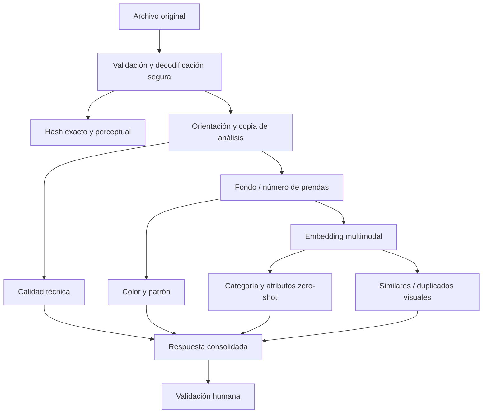
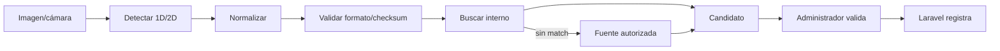

# Visión, identificación y enriquecimiento

**Estado:** diseño y evaluación; no implementado  
**Fecha de consulta de fuentes:** 2026-08-03

## 1. Objetivo y separación de entradas

Una fotografía de portada, una fotografía de etiqueta y una captura de código resuelven problemas diferentes. V2 no obliga a una sola imagen a servir para todo.

| Tipo de captura | Propósito principal | Resultado esperado |
|---|---|---|
| Portada de producto | calidad, color, categoría, atributos, embedding | sugerencias visuales y aptitud de publicación |
| Galería | ángulos/detalles y duplicados | cobertura visual y derivados |
| Código | barcode/QR enfocado | identificador normalizado o `unreadable` |
| Etiqueta | marca, talla, composición, cuidado, modelo | campos OCR candidatos con regiones/evidencia |
| Fuente externa | comparación, no verdad | candidatos con procedencia y derechos |

La identificación exacta de una prenda genérica por fotografía no es garantizable. Sin código, ficha del proveedor o referencia autorizada, el resultado correcto es un conjunto de candidatos, no una identidad afirmada.

## 2. Pipeline visual de portada



### 2.1 Validación del archivo

No se confía en extensión ni `Content-Type`. El pipeline debe comprobar:

- firma y MIME real contra lista permitida;
- decodificación completa y ausencia de truncamiento;
- dimensiones, megapíxeles, relación de aspecto y límites anti-bomba;
- cantidad de frames; rechazar animación cuando el contrato espera una imagen;
- orientación EXIF aplicada en la copia de trabajo;
- perfil de color y conversión controlada a sRGB;
- presencia de alpha, profundidad y formato;
- tamaño de bytes y presupuesto de memoria tras decodificar;
- metadatos EXIF: no exponer ubicación/dispositivo y eliminarlos de derivados;
- hash SHA-256 del binario original y hash del píxel normalizado.

El original no se modifica. Toda corrección ocurre en una copia de análisis o derivado versionado.

### 2.2 Calidad técnica

Primer enfoque determinista y CPU:

- desenfoque: varianza del Laplaciano y/o energía de altas frecuencias, calibrada por resolución;
- exposición: proporción de sombras/altas luces recortadas e histograma de luminancia;
- contraste: rango y distribución robusta, no solo desviación global;
- balance de blancos dominante como advertencia, no corrección automática del color comercial;
- resolución útil del objeto y margen respecto al encuadre;
- fondo: uniformidad, textura y contaminación cromática;
- obstrucción/corte: heurística y, después, detector/segmentador;
- una o varias prendas: inicialmente advertencia por componentes/embedding; después detector entrenado.

Los umbrales deben calibrarse con un conjunto local etiquetado `apta/no_apta` y razones. No existe un umbral universal de Laplaciano que funcione en todas las cámaras.

### 2.3 Color

Inicio:

1. trabajar en Lab/HSV sobre píxeles plausibles de prenda;
2. reducir fondo cuando sea uniforme;
3. muestrear de forma reproducible;
4. agrupar con K-Means o histograma cuantizado;
5. convertir centroides a una paleta comercial versionada;
6. devolver porcentajes, distancia a paleta y advertencia de fondo/iluminación.

K-Means es clustering, no una red neuronal. Sin segmentación fiable, el color del fondo puede dominar; por eso la salida debe incluir `foreground_confidence` y abstenerse cuando sea baja.

### 2.4 Patrón y atributos

Taxonomía inicial cerrada y pequeña: `liso`, `rayas`, `cuadros`, `floral`, `animal_print`, `gráfico`, `texturizado`, `otro`, `incierto`. Material, ocasión, corte y silueta deben separarse porque una imagen puede no demostrar composición o elasticidad.

Salida por atributo:

- valor canónico;
- top-k si aplica;
- confianza calibrada;
- evidencia visual/textual;
- `observable_from_image`;
- advertencia de ambigüedad.

Nunca inferir composición textil como hecho solo por apariencia; el OCR de etiqueta o proveedor autorizado tiene mayor prioridad.

## 3. Clasificación y embeddings

### 3.1 Comparación de familias

| Familia | Naturaleza | Ventaja | Límite en Mati Boutique | Uso V2 |
|---|---|---|---|---|
| SigLIP ViT | transformer visual-textual multimodal | buen zero-shot y embeddings | requiere prompts/taxonomía y benchmark local | candidato inicial |
| CLIP ViT | transformer visual-textual multimodal | baseline conocido y ecosistema amplio | su model card original no valida bien multilingüe | baseline objetivo |
| FashionSigLIP/FashionCLIP | multimodal especializado en moda | vocabulario/representación del dominio | pesos, código remoto/dataset y licencia deben auditarse | benchmark offline opcional |
| ResNet | CNN clásica | baseline robusto para fine-tuning | necesita etiquetas y puede perder detalle fino | transfer learning futuro |
| EfficientNet | CNN eficiente | buena relación costo/calidad | necesita dataset y calibración | candidato futuro |
| MobileNet | CNN eficiente móvil | baja latencia | menor capacidad para atributos finos | edge/CPU futuro |
| ConvNeXt | convolucional moderna | representación competitiva y transferible | mayor costo y datos propios | candidato de transfer learning |
| YOLO | detector supervisado | localiza múltiples objetos | licencia Ultralytics y falta de clases fashion propias | no default; evaluar alternativa/licencia |
| RT-DETR | detector transformer | detección end-to-end | stack adicional y clases genéricas no resuelven moda fina | fase posterior |
| Mask R-CNN | detector/segmentador supervisado | máscara por instancia | anotaciones y cómputo | benchmark con dataset propio |
| SAM2 | segmentador general promptable | ayuda a crear/ajustar máscaras | no asigna semántica fashion y necesita prompt | herramienta asistida futura |

SigLIP y CLIP en sus variantes ViT no son CNN clásicas. ResNet, EfficientNet y MobileNet sí son CNN. ConvNeXt sigue siendo convolucional. KNN y K-Means tampoco son redes neuronales.

### 3.2 Recomendación inicial

- **Modelo candidato:** un SigLIP base compatible con el hardware y fijado a una revisión exacta.
- **Baseline:** CLIP con la misma taxonomía, imágenes y protocolo.
- **Sin detector en MVP1:** fondo controlado, reglas, revisión y abstención entregan mejor relación riesgo/valor.
- **Búsqueda:** embedding normalizado y similitud coseno; con 13 prendas, búsqueda exacta es preferible a un índice aproximado.
- **Prompts:** plantillas en español e inglés cuando el model card justifique el idioma; promediar variantes y medirlas, no asumir traducción perfecta.
- **Calibración:** top-3, margen top1–top2, clase `otro/incierto`, ECE/Brier y umbral por categoría si hay datos.

Fuentes primarias: [CLIP de OpenAI](https://openai.com/index/clip/), [paper de CLIP](https://arxiv.org/abs/2103.00020), [model card de CLIP](https://github.com/openai/CLIP/blob/main/model-card.md), [paper de SigLIP](https://arxiv.org/abs/2303.15343) y [documentación SigLIP en Transformers](https://huggingface.co/docs/transformers/model_doc/siglip).

### 3.3 Moda especializada y datasets

[Marqo FashionSigLIP](https://huggingface.co/Marqo/marqo-fashionSigLIP) puede evaluarse como candidato especializado. Su ruta de carga publicada usa código remoto personalizado; cualquier prueba futura debe fijar revisión, revisar ese código y comprobar licencia de pesos/datos, no habilitar `trust_remote_code` ciegamente.

[DeepFashion](https://mmlab.ie.cuhk.edu.hk/projects/DeepFashion.html) ofrece taxonomías y benchmarks, pero su sitio establece uso no comercial para investigación y advierte que las imágenes de Internet no pertenecen a MMLAB. No debe convertirse en dataset de entrenamiento comercial de Mati Boutique. [DeepFashion2](https://github.com/switchablenorms/DeepFashion2) es valioso como referencia de detección, pose, segmentación y retrieval, pero acceso/licencia de imágenes y derivados requieren aprobación expresa antes de cualquier uso productivo.

### 3.4 Transfer learning con compuertas

Secuencia obligatoria:

1. congelar taxonomía y guía de etiquetado;
2. ejecutar SigLIP y CLIP zero-shot en shadow;
3. capturar confirmaciones/correcciones humanas y contexto de imagen;
4. limpiar, deduplicar y separar por producto/sesión para evitar fuga;
5. entrenar candidatos CNN/ConvNeXt fuera de producción;
6. comparar sobre test bloqueado: macro-F1, recall por clase, calibración, cobertura/abstención, latencia y VRAM;
7. activar solo si mejora el criterio preaprobado y no degrada clases críticas.

Un gran número de imágenes del mismo producto no equivale a diversidad de productos. El split debe evitar que fotos casi idénticas aparezcan en train y test.

## 4. Detección y segmentación

### 4.1 Cuándo son necesarias

- varias prendas en una imagen;
- fondo complejo que contamina color;
- recorte/centrado automático;
- máscara para derivados o VTO;
- atributos localizados;
- control de área visible de la prenda.

No son prerequisito del primer MVP. Primero se debe medir qué porcentaje de fotos reales falla con un protocolo de captura simple.

### 4.2 Candidatos y restricciones

- [Tutorial oficial de Torchvision para detección y Mask R-CNN](https://docs.pytorch.org/tutorials/intermediate/torchvision_tutorial.html): útil para transfer learning con anotaciones propias y el stack PyTorch ya previsto.
- [SAM2](https://github.com/facebookresearch/sam2): Apache-2.0 para código/checkpoints publicados, promptable; útil como herramienta de máscara o preanotación, no como clasificador de moda.
- [PaddleDetection/RT-DETR](https://github.com/PaddlePaddle/PaddleDetection): activo y Apache-2.0, pero introduce Paddle y complejidad operativa; no debe incorporarse sin benchmark que justifique otro framework.
- [Ultralytics YOLO](https://www.ultralytics.com/license): ofrece AGPL-3.0 y licencia Enterprise. Para un producto propietario/comercial se requiere decisión jurídica/comercial; no es candidato default.

El detector general entrenado en COCO puede encontrar `person` u objetos amplios, pero no garantiza distinguir las categorías y siluetas de la boutique.

## 5. Identificación por código

### 5.1 Tipos de identificador

| Clase | Significado | Prioridad de búsqueda |
|---|---|---|
| SKU Mati | identificador interno controlado | catálogo interno |
| GTIN/EAN/UPC | llave global con estructura/checksum | interno → fuente GS1/proveedor autorizada |
| QR | contenedor que puede incluir texto/URL/ID | validar esquema; nunca navegar automáticamente |
| Código de proveedor | identificador dentro de una relación comercial | catálogo/feed del proveedor |
| Código de modelo | agrupa un diseño; puede no identificar variante | proveedor/marca y reconciliación |
| Texto impreso | evidencia OCR no estructurada | matching con marca/modelo/talla |

Un código de barras normalmente codifica una llave, no una ficha completa. Precio, material, imágenes y talla deben recuperarse de una base relacionada y verificarse.

### 5.2 Pipeline



Estados de salida separados:

1. `internal_match`: código ya asociado a una variante Mati.
2. `external_gtin_candidate`: GTIN válido sin match interno, con evidencia externa.
3. `supplier_code_candidate`: código válido solo en contexto de proveedor.
4. `unreadable`: no se pudo leer con confianza; solicitar nueva captura/OCR.
5. `no_code`: imagen válida sin símbolo detectable.
6. `conflict`: el mismo código apunta a entidades incompatibles; bloqueo manual.

### 5.3 Lectores evaluados

| Opción | Estado | Ventaja | Decisión |
|---|---|---|---|
| [OpenCV BarcodeDetector](https://docs.opencv.org/4.x/dc/df7/classcv_1_1barcode_1_1BarcodeDetector.html) y [QRCodeDetector](https://docs.opencv.org/4.x/de/dc3/classcv_1_1QRCodeDetector.html) | OpenCV ya está previsto en dependencias | sin nuevo stack; detección/decode básico | primer intento y benchmark |
| [ZXing-C++](https://github.com/zxing-cpp/zxing-cpp) | activo, Apache-2.0, bindings Python | amplia simbología 1D/2D y mantenimiento actual | candidato preferido si OpenCV no alcanza |
| [pyzbar](https://github.com/NaturalHistoryMuseum/pyzbar) | wrapper MIT sobre zbar LGPL | API simple | no preferido: dependencia nativa y compatibilidad publicada menos actual |
| OCR | fallback | recupera dígitos/texto visible | no reemplaza detector/checksum |

No se instala ninguna opción en esta fase documental.

### 5.4 Normalización y validación

- conservar `raw_value`, `normalized_value`, simbología detectada y región;
- retirar espacios/guiones solo según esquema;
- preservar ceros iniciales;
- calcular checksum local EAN/UPC/GTIN antes de una consulta;
- no «corregir» automáticamente un dígito sin mostrar alternativas;
- asociar ámbito para códigos de proveedor;
- evitar que `cob_prv` mezcle GTIN, proveedor y QR sin `identifier_type` futuro;
- un GTIN válido estructuralmente no prueba que el producto candidato sea correcto.

[Verified by GS1](https://www.gs1.org/services/verified-by-gs1) puede verificar identidad/licencia de GTIN dentro de su cobertura, límites y planes; no se debe asumir que siempre devuelve atributos o imágenes completas. La prioridad sigue siendo catálogo interno y feed del proveedor.

## 6. OCR de etiquetas

### 6.1 Pipeline separado

```text
foto de etiqueta
→ validar y orientar
→ detectar regiones de texto/código
→ corregir perspectiva y contraste local
→ OCR por región
→ clasificar campo
→ normalizar
→ fuzzy match contra catálogos controlados
→ confianza por campo
→ revisión humana
```

Campos: marca, talla, composición, instrucciones de cuidado, país/origen si procede, código de modelo, SKU, GTIN visible y texto no clasificado.

### 6.2 Comparación

| Motor | Ventaja | Límite | Posición V2 |
|---|---|---|---|
| [Tesseract 5](https://github.com/tesseract-ocr/tesseract) | Apache-2.0, CPU, idiomas amplios y maduro | necesita preprocesamiento; texto curvo/estilizado difícil | baseline inicial |
| [EasyOCR](https://github.com/JaidedAI/EasyOCR) | PyTorch y detección+reconocimiento accesible | release menos reciente y costo de modelo | candidato de benchmark |
| [PaddleOCR](https://github.com/PaddlePaddle/PaddleOCR) | activo, detección/orientación/reconocimiento potentes | introduce Paddle y stack adicional | candidato si demuestra mejora clara |
| [TrOCR](https://huggingface.co/docs/transformers/model_doc/trocr) | transformer de reconocimiento compatible con Transformers | requiere buenos recortes/detector; no es pipeline de layout completo | futuro para regiones difíciles |

Alternativas compatibles con PyTorch deben compararse por exactitud de campo, no solo CER global. Marca/talla/modelo pueden tener costos de error diferentes.

### 6.3 Extracción estructurada y validación

- marca: fuzzy match contra `marcas`, con umbral y lista de candidatos;
- talla: normalización contextual (`XS`, `S`, `M`, numérica, EU/US/UK), sin perder texto original;
- composición: pares material–porcentaje; validar suma aproximada y conservar idioma;
- cuidado: símbolos y texto como datos separados;
- GTIN: pasar por checksum y búsqueda interna;
- modelo/SKU: no confundir por cercanía visual; usar posición y patrones del proveedor;
- cada campo incluye bounding box, texto bruto, normalizado, confianza y razón de advertencia.

OCR nunca crea automáticamente marca, talla, variante o producto. Si el catálogo no contiene el valor, se presenta `unmapped_candidate`.

## 7. Matching de producto

El matching no es una sola distancia. Combina evidencia con reglas de bloqueo:

```text
hard match: SKU interno exacto
high evidence: GTIN exacto válido + fuente compatible
medium evidence: proveedor + modelo + variante
soft evidence: marca/texto + embedding visual + color/categoría
```

Ejemplo de score conceptual:

```text
score = w_code·code_match
      + w_brand·brand_match
      + w_model·model_match
      + w_text·text_similarity
      + w_image·cosine_similarity
      + w_attrs·attribute_consistency
      - conflict_penalties
```

Los pesos se versionan y se validan. Un conflicto de GTIN/marca no puede compensarse solo con alta similitud visual. Se devuelven componentes del score, no un número opaco.

## 8. Enriquecimiento externo

### 8.1 Jerarquía de fuentes

1. catálogo interno;
2. feed/API/CSV/XML del proveedor con acuerdo;
3. sitio/API oficial de marca autorizado;
4. API de datos autorizada;
5. fuente pública permitida;
6. búsqueda web controlada;
7. scraping específico permitido;
8. carga manual asistida.

Google Custom Search JSON API está [cerrada a nuevos clientes](https://developers.google.com/custom-search/v1/overview) y los existentes deben transicionar antes de 2027; no debe ser dependencia nueva de la arquitectura.

### 8.2 Puertos desacoplados

```text
ExternalProductSource
  search_by_gtin(query, context)
  search_by_model_code(query, context)
  search_by_text(query, context)
  search_by_image(image_ref, context)
  fetch_product(external_id)
  fetch_images(external_id)
```

Cada adaptador normaliza:

- `source_id`, `source_type`, `reliability`;
- `external_id`, `canonical_url`, `fetched_at`, `expires_at`;
- título, marca, códigos, atributos y moneda/precio solo como evidencia;
- imágenes con URL, dimensiones, hash, derechos conocidos y advertencias;
- metadatos de respuesta y `raw_snapshot_ref` opcional;
- estado de términos, robots, rate limit y parser.

Laravel nunca depende del DOM de una tienda. Solo el adaptador conoce endpoints o selectores; un cambio de HTML genera fallo aislado y no datos silenciosamente corruptos.

### 8.3 Configuración obligatoria por fuente

| Control | Contenido mínimo |
|---|---|
| Autenticación | tipo, secreto administrado y alcance |
| Términos | URL/versión, usos permitidos y fecha de revisión |
| Robots | política por user-agent y rutas; [RFC 9309](https://www.rfc-editor.org/rfc/rfc9309) |
| Límites | por minuto/día, concurrencia, backoff y `Retry-After` |
| Cache | TTL, revalidación y derecho a conservar |
| Derechos | texto/datos/imagen por separado; `unknown` bloquea publicación |
| Trazabilidad | request, consulta, URL, fecha, status, parser y hash |
| Cambios | tests con fixtures autorizadas y monitor de parsing |
| Bloqueos | detener/reprogramar; no rotar identidades para evadir |
| Fiabilidad | cobertura, frescura, historial de errores y conflictos |

Scraping masivo indiscriminado queda fuera de alcance.

### 8.4 Descarga temporal segura

Una URL proporcionada por usuario o fuente es hostil. El componente aplica la guía de [OWASP para prevención de SSRF](https://cheatsheetseries.owasp.org/cheatsheets/Server_Side_Request_Forgery_Prevention_Cheat_Sheet.html):

- dominios autorizados cuando sea posible;
- solo HTTPS y puertos aprobados;
- resolver y bloquear loopback, privados, link-local, multicast y metadatos cloud;
- revalidar tras DNS y cada redirección; limitar redirecciones;
- no reenviar cookies/Authorization entre dominios;
- timeout de conexión/lectura, límite de bytes y streaming;
- validar firma/MIME tras descargar;
- no procesar SVG/HTML como imagen raster sin política específica;
- almacenar en cuarentena temporal y borrar por TTL;
- registrar hash y fuente, no contenido completo en logs.

### 8.5 Ranking de candidatos

Etapas:

1. deduplicar por URL canónica, identificadores y hashes;
2. descartar fuente/derechos/payload inseguros;
3. coincidencia exacta de códigos;
4. consistencia de marca/modelo/talla/color;
5. similitud textual y visual;
6. calidad/resolución de imagen;
7. confiabilidad/frescura de fuente;
8. penalizar conflictos y derechos desconocidos;
9. devolver top-k con explicación.

La UI muestra imagen, fuente, dominio, URL original, título, marca, código, resolución, similitud visual/textual, fecha, advertencias y condición de uso conocida.

## 9. Derechos de imágenes

Una imagen visible en Internet no es automáticamente de dominio público; la [FAQ de copyright de WIPO](https://www.wipo.int/en/web/copyright/faq-copyright) explica que normalmente se requiere autorización para usar obras protegidas. Por eso:

- `rights_status` es `owned`, `licensed`, `provider_authorized`, `public_domain`, `unknown` o `prohibited`;
- `unknown` y `prohibited` nunca pasan a publicación;
- se guarda evidencia del permiso/licencia y su alcance/expiración;
- seleccionar un candidato no equivale a aprobar derechos;
- la imagen externa no sustituye automáticamente al original de Mati;
- un cambio de términos puede bloquear futuras publicaciones y exigir revisión.

## 10. Preparación para publicación

### 10.1 Ciclo de vida de activos

| Clase | Mutabilidad/uso | Retención |
|---|---|---|
| Original | inmutable, privado hasta aprobar | política comercial |
| Copia de análisis | normalizada, no publicable | corta/reproducible |
| Candidato externo | cuarentena, evidencia | TTL corto según fuente |
| Aprobada | selección humana + derechos | auditable |
| Derivado de publicación | reproducible desde aprobada y perfil | regenerable |

### 10.2 Pipeline determinista inicial

```text
activo aprobado
→ auto-orientar
→ convertir a sRGB
→ eliminar EXIF del derivado
→ recorte/centrado conservador
→ resize por perfil
→ mejora moderada reproducible
→ compresión y formato
→ hash y nombre seguro
→ miniatura/tarjeta/detalle
→ alt text candidato revisable
→ manifiesto de procedencia
```

Perfiles conceptuales: `thumbnail`, `card`, `detail` y, si se aprueba, `zoom`. Cada perfil fija dimensiones máximas, crop, fondo, codec, calidad, versión y checksum. WebP es candidato general; AVIF debe adoptarse solo tras verificar compatibilidad, costo de encode y fallback. El original no se borra ni recompone.

### 10.3 Fases futuras

- eliminación/fondo uniforme: solo con máscara revisable;
- super-resolution: advertir que sintetiza detalle, comparar contra original;
- inpainting: restringido a fondo/artefactos no comerciales;
- variantes publicitarias: etiquetadas como generadas, nunca ficha fiel sin revisión;
- marca de agua: política comercial y derivados separados.

Una transformación que pueda modificar color, patrón, logo, textura, corte o accesorios debe quedar bloqueada o marcada `commercial_fidelity_risk` y exigir aprobación humana lado a lado con el original.

## 11. Contrato funcional de salida

Toda respuesta de este dominio debe separar:

- `observations`: medidas deterministas (dimensiones, hashes, regiones);
- `predictions`: categoría/color/texto con confianza y versión;
- `matches`: candidatos internos/externos con evidencia;
- `warnings`: calidad, conflicto, derechos, seguridad o falta de datos;
- `abstentions`: tareas que no pudieron resolverse;
- `artifacts`: referencias opacas temporales, nunca rutas internas arbitrarias;
- `human_review_required: true` para datos comerciales.

## 12. Métricas y criterios de activación

| Tarea | Métrica mínima de evaluación |
|---|---|
| Validación | falsos negativos de archivos válidos y evasiones detectadas |
| Calidad | precision/recall por motivo y acuerdo con revisores |
| Color | delta E/paleta, exactitud top-k y tasa de abstención |
| Categoría | macro-F1, recall por clase, top-3, calibración y cobertura |
| Duplicado exacto | 100% por hash del mismo binario; política para normalizados |
| Duplicado visual | precision@k y casos difíciles por producto |
| Barcode/QR | tasa de lectura y exactitud por simbología/condición |
| OCR | exactitud por campo, CER/WER y tasa de corrección humana |
| Matching | precision@1/3, MRR y conflictos de código |
| Enriquecimiento | candidatos útiles, fuente, derechos claros y latencia |
| Publicación | fidelidad visual, peso, compatibilidad y revisión lado a lado |

No se activa escritura sugerida por defecto hasta que el usuario pueda revisar, corregir y registrar el feedback de forma explícita.

## 13. Fuentes principales adicionales

- [OpenCV BarcodeDetector](https://docs.opencv.org/4.x/dc/df7/classcv_1_1barcode_1_1BarcodeDetector.html)
- [ZXing-C++](https://github.com/zxing-cpp/zxing-cpp)
- [Tesseract OCR](https://github.com/tesseract-ocr/tesseract)
- [PaddleOCR](https://github.com/PaddlePaddle/PaddleOCR)
- [SAM2](https://github.com/facebookresearch/sam2)
- [Verified by GS1](https://www.gs1.org/services/verified-by-gs1)
- [OWASP SSRF Prevention Cheat Sheet](https://cheatsheetseries.owasp.org/cheatsheets/Server_Side_Request_Forgery_Prevention_Cheat_Sheet.html)
- [Robots Exclusion Protocol, RFC 9309](https://www.rfc-editor.org/rfc/rfc9309)
