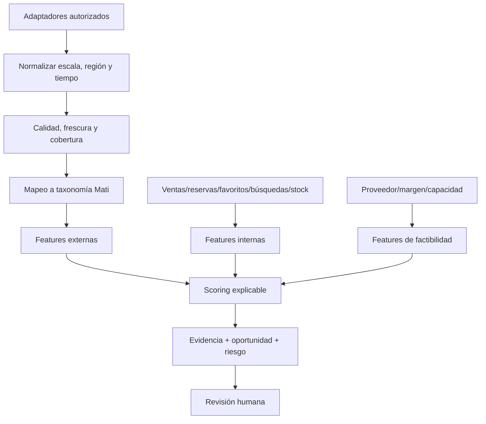

# Tendencias y fuentes externas

**Estado:** diseño condicionado por accesos externos  
**Fecha de verificación de documentación oficial:** 2026-08-03

## 1. Propósito

El dominio de tendencias transforma señales externas autorizadas en evidencia comparable con la operación interna. No intenta «adivinar la moda» ni generar órdenes de compra. Su producto es una observación con procedencia, escala, incertidumbre y acción sugerida revisable.

V2 separa cuatro conceptos:

- **Tendencia externa:** crecimiento/persistencia de un término o rasgo en una fuente.
- **Demanda interna:** ventas, reservas, favoritos, búsquedas y conversiones propias.
- **Coincidencia:** alineación semántica entre la taxonomía externa y el catálogo Mati.
- **Oportunidad:** decisión multicriterio que además considera margen, stock, proveedor, riesgo y capacidad.

Una señal externa alta con demanda interna nula puede justificar observar o probar un lote pequeño; no justifica reponer automáticamente.

## 2. Disponibilidad real de las fuentes

### 2.1 Instagram: solo cuenta propia autorizada

La [documentación oficial de Instagram API de Meta](https://www.postman.com/meta/instagram/documentation/6yqw8pt/instagram-api) distingue autenticación mediante Instagram Login o Facebook Login y sus permisos. Los insights se orientan a cuentas profesionales y a medios/cuentas que la aplicación está autorizada a gestionar. Hay métricas condicionadas por tamaño/actividad, datos que pueden devolverse vacíos y métricas de usuario que la documentación indica que se almacenan hasta 90 días; Mati debe tomar snapshots permitidos si necesita comparaciones más largas.

Uso V2 permitido:

- publicaciones y métricas de la cuenta profesional propia de Mati Boutique;
- alcance, interacciones, guardados/compartidos/clics cuando la API y permisos los expongan;
- captions, hashtags y medios propios dentro de términos;
- snapshots periódicos porque algunas métricas no permanecen indefinidamente;
- `Standard Access` o `Advanced Access` según propiedad de la cuenta y modelo de servicio, confirmado en la configuración real.

No permitido por diseño:

- scraping del sitio o aplicación Instagram;
- recolección masiva de perfiles, hashtags o medios ajenos;
- automatización evasiva ante login, rate limits o bloqueos;
- asumir acceso público universal.

Los [términos de recopilación automatizada de Meta](https://www.facebook.com/legal/automated_data_collection_terms) requieren permiso escrito expreso para la recopilación automatizada. Aceptar términos no equivale a obtener ese permiso. Por tanto, `InstagramPublicScraperAdapter` no existe en V2.

**Estado:** dependiente de cuenta profesional, aplicación Meta, permisos y revisión vigente. Fallback: exportación/importación manual de métricas propias.

### 2.2 Pinterest Trends

La [Pinterest Trends API](https://developers.pinterest.com/docs/analytics-and-reports/trends/) está orientada a agencias, clientes Enterprise y plataformas partner. La documentación describe hasta 50 resultados, crecimiento semanal/mensual/anual y una serie semanal normalizada 0–100 del último año; no representa volumen absoluto de compras. La consulta usa la fecha actual documentada, no un archivo histórico arbitrario. La API requiere acceso y scope; los [límites oficiales](https://developers.pinterest.com/docs/reference/rate-limits/) dependen de endpoint/cuenta y deben leerse en la respuesta/configuración.

**Estado:** restringido; acceso no asumido. Fallback: exportación/manual snapshot permitido por la cuenta, con fecha y región.

### 2.3 Google Trends

Google anunció una [Google Trends API](https://developers.google.com/search/apis/trends) en alpha con acceso limitado a testers. La documentación actual ofrece una ventana móvil de cinco años, agregación diaria/semanal/mensual/anual, regiones/subregiones y datos consistentemente escalados, pero sigue siendo alpha; no debe tratarse como API pública estable ni como volumen absoluto de búsquedas. El [anuncio oficial](https://developers.google.com/search/blog/2025/07/trends-api) contextualiza su acceso temprano.

**Estado:** alpha/restringido. Fallback: importación manual de snapshots/exportaciones permitidas. No se diseña scraping del sitio de Trends como sustituto.

### 2.4 Proveedores y marcas

Orden recomendado:

1. API/feed contratado del proveedor;
2. CSV/XML/Excel exportado por el proveedor;
3. sitio oficial con permiso y términos compatibles;
4. carga manual asistida.

Esta fuente puede aportar disponibilidad, fecha, mínimo, múltiplos, lead time, categorías, modelos, colores, precios y material. Ningún dato se convierte en maestro automáticamente; la procedencia y la versión se conservan.

**Estado:** potencialmente la fuente externa de mayor valor comercial, pero hoy no existen proveedor ni feed en el esquema real.

### 2.5 Otras fuentes

Una nueva fuente requiere una decisión de admisión: propósito, base contractual, términos, cobertura geográfica, estabilidad, costo, privacidad, licencias, normalización y plan de salida. «Datos públicos» no significa automáticamente «reutilizables».

## 3. Arquitectura de adaptadores

```text
TrendSource
  capabilities()
  fetch_terms(window, region, filters)
  fetch_time_series(term, window, region)
  fetch_posts(window, filters)
  fetch_metrics(entity_ids, window)
```

Implementaciones conceptuales:

```text
InstagramOwnAccountAdapter
PinterestTrendsAdapter
GoogleTrendsAdapter
SupplierCatalogAdapter
OfficialBrandAdapter
ManualTrendImportAdapter
```

Cada adaptador declara capacidades porque no todas las fuentes entregan posts, series, imágenes y métricas con el mismo significado.

### 3.1 Salida normalizada

```json
{
  "source_id": "pinterest-trends",
  "source_type": "trend_api",
  "observation_type": "normalized_interest",
  "external_key": "...",
  "term_raw": "...",
  "term_canonical": "...",
  "region": "...",
  "period_start": "...",
  "period_end": "...",
  "value": 73.0,
  "value_scale": "source_normalized_0_100",
  "growth": {"wow": null, "mom": null, "yoy": null},
  "fetched_at": "...",
  "freshness_until": "...",
  "reliability": 0.0,
  "rights_status": "metadata_only",
  "warnings": [],
  "raw_snapshot_ref": null
}
```

Nunca se mezclan valores de escalas distintas como si fueran unidades homogéneas. Instagram `saves`, Google interés normalizado, Pinterest crecimiento y ventas internas requieren normalización y explicación.

## 4. Pipeline de señales



### 4.1 Ingesta

- `watermark` por fuente y período;
- idempotencia por fuente, métrica, entidad, región y ventana;
- cache acorde a términos, no una copia ilimitada por conveniencia;
- snapshot de respuesta o hash cuando el contrato lo permita;
- backoff, `Retry-After` y circuit breaker;
- resultado parcial si una fuente falla;
- no interpolar silenciosamente huecos.

### 4.2 Normalización temporal

- mantener zona horaria original y UTC;
- registrar granularidad (`day`, `week`, `month`);
- no comparar una semana parcial con una completa;
- alinear calendarios y eventos locales;
- conservar revisiones si la fuente corrige datos;
- distinguir `event_time`, `period_end` y `fetched_at`.

### 4.3 Mapeo semántico

Se requiere una taxonomía Mati versionada para categoría, prenda, patrón, color, estilo, silueta y ocasión. El término «tejido» puede referirse a técnica, textura o tipo de producto; el mapeo debe guardar candidatos y confianza.

Orden:

1. diccionario curado y sinónimos;
2. reglas de idioma/normalización;
3. matching textual/embedding;
4. revisión humana de términos nuevos;
5. publicación en un vocabulario versionado.

Un LLM puede proponer mapeos en una fase posterior, pero no debe inventar una categoría maestra ni ocultar la fuente.

## 5. Análisis textual y visual

### 5.1 Texto

Señales posibles: hashtags, captions propias, términos relacionados, consultas internas, descripciones de proveedor y nombres de modelo.

Técnicas progresivas:

- conteos, n-grams, normalización y diccionario;
- TF-IDF/BM25 para términos;
- embeddings multilingües o multimodales para mapping;
- clasificación zero-shot contra taxonomía;
- clustering exploratorio con revisión, nunca alta automática.

Se conservan frecuencia, fuente, período y población. Una mención no equivale a intención de compra.

### 5.2 Visual

Solo se analizan medios propios, de proveedor o con derecho compatible. Se pueden extraer embeddings, paleta, categoría/patrón/silueta candidatos y agrupar señales. La imagen no se reutiliza para catálogo ni entrenamiento si la licencia solo permite análisis o visualización.

El análisis visual de publicaciones propias puede relacionar atributos con alcance/guardados/clics. Para evitar conclusiones falsas debe controlar fecha, inversión publicitaria, formato, audiencia y exposición.

## 6. Features recomendadas

### 6.1 Externas

- nivel normalizado por fuente;
- crecimiento WoW/MoM/YoY cuando la fuente lo entregue;
- pendiente robusta y aceleración;
- persistencia y número de períodos presentes;
- volatilidad y reversión;
- consenso entre fuentes independientes;
- recencia, cobertura regional y fiabilidad;
- categoría/color/patrón/estilo mapeados;
- saturación o riesgo de moda breve.

### 6.2 Internas

- unidades e ingresos válidos;
- tasa de reservas completadas/canceladas;
- favoritos y búsquedas, una vez instrumentados;
- impresiones, clics y conversión, una vez instrumentados;
- días con stock y stockout estimado;
- velocidad de venta, margen, markdown y devoluciones futuras;
- cobertura por talla/color y ubicación.

### 6.3 Factibilidad

- proveedor autorizado y disponibilidad;
- lead time y variabilidad;
- mínimo/múltiplo;
- costo y margen esperado;
- presupuesto/capacidad de compra;
- similitud con inventario actual y canibalización;
- riesgo de derechos/temporada/obsolescencia.

## 7. Score explicable

No se prescribe una fórmula definitiva antes de tener datos. Un score inicial por reglas puede ser:

```text
external_trend = weighted_growth × persistence × source_quality
internal_demand = velocity × conversion × in_stock_correction
alignment       = taxonomy_match × catalog_gap
feasibility     = supplier_availability × margin × lead_time_fit
risk            = volatility + rights_risk + obsolescence + missing_data

opportunity = w1·external_trend
            + w2·internal_demand
            + w3·alignment
            + w4·feasibility
            - w5·risk
```

Cada término se devuelve por separado, junto con pesos y datos faltantes. No se asigna `0` a un dato desconocido: se conserva `missing`, se reduce confianza y se impide una recomendación fuerte.

### 7.1 Salida de negocio

```json
{
  "subject": {"category": "...", "color": "...", "style": "..."},
  "external_trend": {"score": 0.0, "evidence": []},
  "internal_demand": {"score": 0.0, "evidence": []},
  "alignment": {"score": 0.0, "explanation": "..."},
  "opportunity": {"score": 0.0, "confidence": "low"},
  "risk": {"level": "high", "reasons": []},
  "suggested_action": "observe",
  "missing_data": [],
  "human_review_required": true
}
```

Acciones permitidas: `observe`, `validate_source`, `small_pilot`, `replenish_review`, `increase_variety_review`, `do_not_buy`, `review_supplier`. `replenish_review` sigue siendo una entrada al dominio de reposición, no una orden.

## 8. Relación con demanda y surtido

Tendencias no entra directamente como objetivo del forecast. Primero se evalúa como covariable en backtesting temporal. Si no mejora WAPE/MASE/sesgo o produce inestabilidad, se excluye.

Para surtido:

- una categoría ausente + búsquedas internas sin resultado + proveedor disponible puede justificar lote piloto;
- alta tendencia externa sin margen/proveedor es solo observación;
- ventas internas altas con tendencia externa baja pueden justificar reposición, no descarte;
- el score debe ser calculado con la información disponible en la fecha de decisión para evaluar después el resultado.

## 9. Resiliencia ante fuentes ausentes

| Fuente ausente | Degradación correcta |
|---|---|
| Instagram API | importar métricas propias o analizar solo datos internos |
| Pinterest Trends | snapshot manual o omitir señal Pinterest |
| Google Trends alpha | importación manual o omitir señal Google |
| Proveedor | marcar reposición/surtido incompleto; no inventar disponibilidad |
| Medios externos | análisis textual/metadatos; no descargar sin derechos |
| Todas las externas | analítica interna y reglas siguen operativas |

El score publica `sources_expected`, `sources_available` y cobertura; una baja cobertura reduce confianza, no se disimula reescalando los pesos a 100% sin advertencia.

## 10. Privacidad, términos y seguridad

- No enviar datos de clientes a fuentes de tendencias.
- Tokens con mínimo alcance, almacenados fuera de código y React.
- Registrar permisos, expiración y cuenta/entidad autorizada.
- No guardar captions, comentarios o perfiles ajenos sin propósito y autorización.
- No inferir atributos sensibles de personas en medios.
- Aplicar borrado/revocación cuando la fuente o titular lo exija.
- Respetar derechos de imagen y licencias de datos por separado.
- Las URLs pasan por el fetcher seguro descrito en el documento de visión.
- Las importaciones manuales se validan como archivos hostiles y registran autor/fecha.

## 11. Métricas de calidad del dominio

- cobertura y frescura por fuente/atributo/región;
- tasa de ingestión válida, duplicados y huecos;
- tasa de términos mapeados y corrección humana;
- estabilidad y contribución de cada componente del score;
- precision de oportunidades evaluadas a 4/8/12 semanas;
- resultado de lotes piloto, margen, sell-through y markdown;
- mejora del forecast al añadir señales externas frente al mismo baseline;
- disponibilidad, rate-limit, costo y tiempo de mantenimiento por adaptador.

Una fuente que consume mucho mantenimiento y no mejora decisiones debe retirarse aunque sea popular.

## 12. Compuertas de activación

1. Términos, cuenta y permisos aprobados.
2. Definición semántica de cada métrica documentada.
3. Taxonomía y región compatibles con Mati Boutique.
4. Importación idempotente y auditable.
5. Fallback probado.
6. No exposición de datos personales.
7. Evaluación histórica o piloto que demuestre señal útil.
8. UI muestra evidencia, escala normalizada y limitaciones.

## 13. Fuentes oficiales consultadas

- [Instagram API — colección oficial verificada por Meta](https://www.postman.com/meta/instagram/documentation/6yqw8pt/instagram-api)
- [Meta Automated Data Collection Terms](https://www.facebook.com/legal/automated_data_collection_terms)
- [Pinterest Trends API](https://developers.pinterest.com/docs/analytics-and-reports/trends/)
- [Pinterest API rate limits](https://developers.pinterest.com/docs/reference/rate-limits/)
- [Google Trends API alpha](https://developers.google.com/search/apis/trends)
- [Anuncio de Google Trends API](https://developers.google.com/search/blog/2025/07/trends-api)
