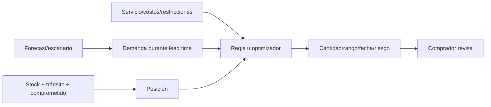

# Analítica, demanda, reposición y surtido

**Estado:** arquitectura analítica; no implementada  
**Base real al 2026-08-03:** 11 ventas, 12 detalles, 18 unidades, 7 días con venta, 8 reservas y 5 favoritos

## 1. Cuatro problemas distintos

| Problema | Pregunta | Salida |
|---|---|---|
| Analítica | ¿Qué ocurrió y con qué calidad de datos? | indicadores y anomalías descriptivas |
| Demanda | ¿Cuánto podría demandarse por horizonte? | distribución/intervalo y forecast |
| Reposición | ¿Cuándo y cuánto pedir de un producto conocido? | propuesta condicionada por suministro/costos |
| Surtido | ¿Qué producto/variante nueva conviene probar? | oportunidad, evidencia y lote piloto |

Un forecast no decide una compra. La reposición usa forecast, stock, lead time y restricciones. El surtido trata incertidumbre y novedad; no es reposición de un SKU existente.

## 2. Evaluación del volumen actual

El volumen actual no permite:

- estimar estacionalidad semanal/mensual por variante;
- validar una LSTM/GRU/TFT;
- aprender afinidades robustas por cliente;
- medir promociones, stockouts o elasticidad;
- usar un holdout temporal representativo.

Sí permite:

- definir semántica y calidad de ventas/reservas/movimientos;
- construir SQL descriptivo reproducible;
- crear snapshots y baselines;
- instrumentar stockouts, promociones, proveedor e interacciones;
- simular el contrato de forecast con estado `insufficient_history`;
- comenzar reglas comerciales explícitas con advertencias.

Con estos datos, cualquier pronóstico numérico por SKU aparentaría precisión sin evidencia. El primer MVP comercial es de **medición y decisión asistida**, no de deep learning.

## 3. Capa analítica confiable

### 3.1 Hechos y semántica

Antes de algoritmos se definen vistas/snapshots conceptuales:

- venta válida: estados incluidos/excluidos, fecha efectiva, devoluciones y anulaciones;
- unidad demandada frente a unidad vendida;
- reserva confirmada, expirada, cancelada y completada;
- stock disponible, reservado, en tránsito y stockout;
- margen: ingreso neto menos costo conocido, con impuestos/descuentos definidos;
- exposición: impresión elegible, posición, contexto y recomendador;
- período y ubicación con zona horaria coherente.

No se cambia la base en esta fase. Estas definiciones deben aprobarse antes de una futura vista o pipeline.

### 3.2 Indicadores descriptivos

- unidades, ventas, ticket e ingreso por período;
- venta/margen por categoría, prenda, variante, color, talla, marca, temporada, rango de precio y ubicación;
- velocidad y rotación con denominadores explícitos;
- sell-through y days of supply;
- edad de inventario y días sin movimiento;
- reservas por estado, cancelación y conversión;
- favoritos/búsquedas/vistas sin conversión cuando existan eventos;
- stockout y demanda potencial censurada;
- cliente recurrente y cohortes cuando la identificación sea suficiente;
- markdown, cambios/devoluciones y ajuste cuando se instrumenten.

No se compara rendimiento de productos sin controlar días disponibles, stock y exposición.

## 4. Patrones comerciales

### 4.1 Niveles de complejidad

| Técnica | Uso | Datos mínimos prácticos | Estado actual |
|---|---|---|---|
| SQL/conteos | ranking, inactividad, cohortes | pocos datos, semántica correcta | viable |
| Reglas expertas | alertas y compatibilidad | criterios aprobados | viable |
| Estadística | intervalos, tests, tendencia | muestras y supuestos | limitada |
| Asociación | productos juntos/secuencia | muchas cestas con 2+ ítems | insuficiente |
| Clustering | perfiles/segmentos | features estables y escala | insuficiente |
| Anomalías ML | ventas/stock atípicos | historia normal representativa | insuficiente |
| Regresión/boosting | drivers y ranking | filas, covariables y holdout | insuficiente |
| Deep learning | patrones de alta capacidad | gran escala/variedad | no recomendable |

### 4.2 Market Basket Analysis

Unidad de cesta: una venta válida, no el detalle individual. Para cada regla `A → B`:

- `support(A∪B)`: proporción de cestas que contiene ambos;
- `confidence(A→B)`: proporción de cestas con A que también contiene B;
- `lift(A→B)`: confidence respecto a la frecuencia base de B.

Apriori es interpretable pero genera candidatos; FP-Growth escala mejor. Con 11 ventas y solo 12 detalles, cualquier regla sería anecdótica. Primero se usan reglas de categoría curadas; la asociación entra cuando haya suficientes cestas multiítem, soporte absoluto y estabilidad temporal.

Las reglas se filtran por stock, talla, época, margen y coherencia; un lift alto con dos casos no es evidencia.

### 4.3 Secuencias

Para «última compra» se necesita cliente, orden temporal y ventana. Actualmente solo una venta identificada impide patrones secuenciales. Inicio: reglas de complementariedad según la última compra disponible. Futuro: transiciones por categoría o sequential pattern mining cuando existan clientes recurrentes y consentimiento/propósito.

### 4.4 RFM y clustering

RFM usa recencia, frecuencia y valor monetario. Primero debe implementarse como segmentos por reglas/percentiles explicables. K-Means tiene sentido solo cuando:

- hay suficientes clientes recurrentes;
- las variables están escaladas y los outliers tratados;
- se compara estabilidad y utilidad contra RFM;
- se entiende que K-Means fuerza grupos aproximadamente esféricos.

DBSCAN puede descubrir ruido/formas no esféricas, pero su sensibilidad a escala y densidad no lo vuelve automáticamente mejor. Ninguno debe asignar tratamiento discriminatorio ni usar atributos sensibles.

### 4.5 Anomalías

Orden recomendado:

1. invariantes y reconciliación de totales;
2. límites/rules y comparación robusta por período;
3. z-score robusto/IQR con estacionalidad cuando exista;
4. Isolation Forest en shadow con suficientes datos.

Una anomalía no es fraude. Es un caso para revisar, con features y período que originaron la señal.

## 5. Pronóstico de demanda

### 5.1 Variable objetivo

El objetivo preferido es unidades demandadas por período, pero hoy solo se observan unidades vendidas. Se debe corregir/etiquetar:

- ventas inválidas, anuladas o devueltas;
- reservas completadas y canceladas sin doble conteo;
- días sin stock, que censuran demanda;
- transferencias/movimientos que no son consumo;
- cambios de catálogo y discontinuación.

Granularidades candidatas: día o semana; el calendario semanal será más estable con poco volumen. Jerarquía: total → ubicación → categoría → prenda → variante, con talla/color como cortes cuando haya soporte.

### 5.2 Métodos comparados

| Método | Cuándo sirve | Limitaciones | Prioridad |
|---|---|---|---|
| Naive último valor | baseline mínimo | inestable en demanda intermitente | obligatorio |
| Naive estacional | historia con período repetido | hoy no existe ciclo suficiente | baseline futuro |
| Promedio móvil | nivel local simple | retrasa cambios y no da causalidad | temprano |
| Suavizamiento exponencial simple | nivel cambiante | no maneja muchos ceros por sí solo | temprano agregado |
| Holt | nivel + tendencia | tendencia puede extrapolar mal | agregado con historia |
| Holt-Winters/ETS | tendencia + estacionalidad | requiere varios ciclos | futuro |
| Croston | tamaño e intervalo de demanda intermitente | sesgo y forecast plano entre eventos | candidato por SKU con historia |
| SBA/TSB | correcciones/obsolescencia intermitente | requieren validación e implementación específica | futuro por SKU |
| ARIMA/SARIMA | autocorrelación/estacionalidad | sensible con series cortas/ceros | agregado futuro |
| Prophet | calendario y cambios de tendencia | dependencia adicional; no soluciona datos escasos | solo benchmark justificado |
| Regresión | covariables explicables | relaciones/errores deben validarse | agregado futuro |
| Random Forest | no linealidad | no extrapola bien; intervalos no nativos | candidato con datos tabulares |
| XGBoost/LightGBM | boosting potente | dependencias nuevas, tuning y leakage | futuro sujeto a aprobación |
| LSTM/GRU | secuencias complejas | muchos datos, tuning y poca interpretabilidad | no ahora |
| TFT | multi-horizonte/covariables e interpretación | alta capacidad/costo y necesita escala | investigación futura |
| Chronos/TimesFM y fundacionales | zero-shot/transfer de series | costo, licencia/pesos, dominio y benchmark | exploración futura, no default |

La [documentación de series temporales de statsmodels](https://www.statsmodels.org/stable/tsa.html) incluye ARIMA, suavizamiento exponencial, ETS y herramientas de diagnóstico. No forma parte de las dependencias actuales y su mención no autoriza instalarlo. [Forecasting: Principles and Practice](https://otexts.com/fpp3/) y su sección de [series de conteos/demanda intermitente](https://otexts.com/fpp3/counts.html) sustentan la evaluación cuidadosa de Croston. El [paper original de Temporal Fusion Transformer](https://arxiv.org/abs/1912.09363) describe un modelo de alta capacidad para multi-horizonte con covariables; no es apropiado para siete días activos. [Chronos](https://github.com/amazon-science/chronos-forecasting) es Apache-2.0 en su repositorio actual y puede ser benchmark futuro, no sustituto de evidencia local.

### 5.3 Selección por régimen

Clasificar cada serie mediante:

- número de períodos y duración cubierta;
- proporción de ceros;
- intervalos de demanda y tamaño no cero;
- stock availability;
- ciclos completos disponibles;
- cambios de catálogo/precio;
- granularidad y jerarquía.

Salida posible:

- `insufficient_history`;
- `baseline_only`;
- `intermittent_candidate`;
- `regular_candidate`;
- `discontinued_or_obsolete`;
- `data_quality_blocked`.

No se rellena una serie recién creada con ceros anteriores a su lanzamiento.

### 5.4 Covariables

- ventas válidas y reservas/cancelaciones;
- disponibilidad, stockout e inventario;
- precio, descuento y promoción;
- calendario, temporada, eventos y feriados definidos;
- ubicación;
- lead time/proveedor para el uso de reposición, no necesariamente objetivo;
- tendencias externas solo si estaban disponibles en la fecha y mejoran backtest;
- atributos de producto para modelos globales futuros.

No incluir variables futuras desconocidas en entrenamiento/evaluación. Para promociones futuras, el usuario debe proporcionar un escenario; no se asumen.

## 6. Backtesting temporal

### 6.1 Protocolo

```text
para cada fecha de corte t:
  entrenar/ajustar usando datos <= t
  pronosticar h=1..H
  comparar con verdad posterior corregida
  registrar error por serie, jerarquía y horizonte
```

- ventanas expanding o rolling según estabilidad;
- cortes múltiples, nunca split aleatorio;
- mismo set de cortes para baseline y candidato;
- parámetros/taxonomías disponibles en el corte;
- evaluar también períodos con cero y stockout;
- intervalos calibrados fuera de muestra;
- champion/challenger y rollback.

Con el volumen actual, no hay suficientes cortes; el endpoint debe responder falta de evidencia.

### 6.2 Métricas

| Métrica | Uso | Advertencia |
|---|---|---|
| MAE | error absoluto interpretable | escala depende de la serie |
| RMSE | penaliza errores grandes | sensible a outliers |
| WAPE | error total ponderado | indefinido cuando demanda total es cero |
| MASE | compara con naive escalado | requiere denominador válido/baseline |
| Sesgo | sobre/subpronóstico sistemático | no sustituye magnitud del error |
| Cobertura de intervalos | incertidumbre calibrada | también medir ancho |
| Error por horizonte | degradación h=1..H | no promediar ocultando horizontes |

MAPE no es métrica principal por ceros. Se reporta por categoría/serie y en agregados ponderados; un promedio global puede ocultar tallas minoritarias.

### 6.3 Criterio de promoción

Un candidato entra solo si:

- supera naive en métrica primaria predefinida y cortes múltiples;
- el sesgo y la cobertura están dentro de límites;
- no degrada segmentos críticos;
- su latencia/costo son aceptables;
- la mejora es estable, no un único período;
- produce explicación y fallback.

## 7. Reposición y abastecimiento

### 7.1 Datos necesarios

| Dato | Estado actual | Efecto si falta |
|---|---|---|
| Stock disponible/reservado | Existe | base utilizable |
| Demanda prevista | No fiable aún | usar baseline/rango o abstener |
| Lead time/variabilidad | Ausente | fecha de quiebre y stock seguridad incompletos |
| Proveedor | Ausente | no hay destino/condiciones de compra |
| Costo de pedido | Ausente | EOQ no calculable |
| Costo de mantenimiento | Ausente | EOQ/optimización incompletos |
| Mínimo/múltiplos | Ausente | cantidad puede ser impracticable |
| Pedidos en tránsito/ETA | Ausente | posición de inventario incorrecta |
| Margen | precio/costo existen en variante | requiere definición neta |
| Obsolescencia | No modelada | riesgo de moda no cuantificado |

### 7.2 Conceptos y fórmulas

**Posición de inventario:**

```text
inventory_position = on_hand + on_order - backorders - committed
```

Debe evitar doble descuento si `on_hand` ya excluye reservado.

**Cobertura:**

```text
days_of_supply = available_stock / expected_daily_demand
```

Si demanda es cero o incierta, se devuelve rango/estado, no infinito engañoso.

**Punto de reorden:**

```text
ROP = expected_demand_during_lead_time + safety_stock
```

**Stock de seguridad** bajo supuestos simples:

```text
SS = z × sigma_lead_time_demand
```

La desviación debe incorporar variabilidad de demanda y lead time cuando ambas sean relevantes. `z` deriva del nivel de servicio aprobado, no de una constante oculta.

**EOQ clásico:**

```text
EOQ = sqrt(2 × annual_demand × order_cost / annual_holding_cost_per_unit)
```

Supone demanda/costos relativamente estables, reposición instantánea y sin restricciones; moda, mínimos y obsolescencia pueden invalidarlo. Hoy no se puede calcular responsablemente porque faltan costos.

**Min–max:** reponer hasta `max` cuando la posición cae bajo `min`; útil inicialmente con parámetros aprobados.

**Newsvendor:** candidato para compra de una sola temporada/lote, balanceando costo de faltante y sobrante; requiere distribución de demanda y costos confiables.

### 7.3 Pipeline de sugerencia



Respuesta:

- variante/producto y ubicación;
- fecha de corte;
- cobertura y posición actual;
- forecast y horizonte/intervalo;
- fecha probable de quiebre como rango;
- cantidad y rango sugeridos;
- proveedor/restricciones consideradas;
- fórmula/modelo/versión;
- nivel de riesgo y explicación;
- datos faltantes;
- escenarios `low/base/high`;
- `human_review_required: true`.

Si faltan lead time, proveedor o costos, el estado es `incomplete_inputs`; se puede mostrar una cobertura descriptiva, no una recomendación fuerte.

### 7.4 Simulación y optimización futura

Monte Carlo puede propagar incertidumbre de demanda/lead time y estimar stockout, sobrante y costo. Optimización restringida puede asignar presupuesto entre variantes respetando mínimos, múltiplos, espacio, talla y proveedor. Ambas requieren funciones de costo aprobadas y nunca ejecutan pedidos.

## 8. Inteligencia de surtido

### 8.1 Unidad de decisión

- nuevo producto/diseño;
- nueva categoría;
- nueva variante de color/talla;
- ampliación de rol/ocasión;
- retiro/liquidación.

Agregar una talla de un producto existente no es necesariamente «nuevo producto»; se trata como expansión de variante con evidencia de talla desatendida.

### 8.2 Evidencia

- tendencias externas con procedencia;
- búsquedas internas sin resultado e impresiones futuras;
- favoritos, reservas, ventas y stockouts;
- categorías/roles/tallas/colores ausentes;
- margen y rango de precio;
- catálogo, disponibilidad, lead time y mínimos del proveedor;
- similitud/canibalización con inventario;
- temporada y riesgo de moda breve;
- presupuesto y capacidad de exhibición/compra.

Hoy faltan búsquedas, proveedor, capacidad y muchas taxonomías; el módulo no es activable en modo fuerte.

### 8.3 Score inicial explicable

```text
market_signal   = external_trend + internal_unmet_demand
portfolio_gap   = category_gap + size_gap + color_gap + role_gap
economics       = margin + price_fit - carrying_risk
supply_fit      = availability + lead_time_fit - minimum_risk
novelty_risk    = short_trend + cannibalization + obsolescence

assortment_score = weighted components - novelty_risk
```

Salida:

- oportunidad y categoría/estilo/color;
- rango de precio y tallas sugeridas;
- proveedor candidato;
- evidencia por componente;
- confianza y datos faltantes;
- lote piloto/rango y horizonte de evaluación;
- criterio de éxito: sell-through, margen, conversión y markdown;
- acción alternativa `observe`/`do_not_buy`.

El lote piloto reduce riesgo y genera verdad local. Popularidad externa por sí sola nunca habilita `buy`.

## 9. Evaluación de decisiones

Toda sugerencia debe cerrarse con un outcome:

- aceptada, modificada, rechazada o expirada;
- razón humana estructurada;
- cantidad/fecha realmente decidida;
- llegada real, ventas, margen, stockout, sobrante y markdown a horizontes definidos;
- comparación con no actuar/baseline cuando sea posible.

Esto permite evaluar el sistema de decisión, no solo el error del forecast.

## 10. Dependencias de datos prioritarias

1. Semántica de venta válida/anulación/devolución.
2. Eventos de stockout y días disponibles.
3. Identificación de cliente cuando sea legítima y opcional.
4. Eventos de vista, búsqueda, impresión, clic y recomendación.
5. Promociones, descuentos y precio efectivo.
6. Proveedor, modelo/código, lead time y variabilidad.
7. Mínimo, múltiplo, costo de pedido/mantenimiento y tránsito.
8. Taxonomía de estilo/patrón/material/ocasión/rol.
9. Calendario de eventos y temporadas relevante.
10. Resultado de decisiones comerciales y lotes piloto.

## 11. Primer alcance comercial recomendado

### Fase A — descriptiva

- diccionario de métricas;
- snapshot reproducible;
- ventas/stock/reservas por cortes existentes;
- inactividad y cobertura con advertencias;
- controles de calidad y conciliación.

### Fase B — baseline y shadow

- endpoint conceptual con `insufficient_history`;
- naive/promedio móvil en nivel agregado cuando haya cortes;
- backtesting temporal automatizable;
- tablero de error y sesgo.

### Fase C — reposición básica

- parámetros manuales de lead time/min–max aprobados;
- cobertura y escenarios, sin EOQ si faltan costos;
- revisión humana y registro de decisión.

### Fase D — modelado y surtido

- Croston/SBA/TSB por series intermitentes maduras;
- ETS/ARIMA/boosting en agregado si superan baselines;
- score de surtido y lotes piloto;
- señales externas solo si aportan mejora medible.

## 12. Riesgos específicos

- confundir ausencia de stock con ausencia de demanda;
- fuga temporal al usar datos posteriores o catálogos actuales;
- sobreajuste por SKU y jerarquía pequeña;
- optimizar forecast sin optimizar costo/servicio;
- EOQ con supuestos violados y datos inventados;
- sesgo hacia productos con más exposición/stock;
- asociación espuria por pocas cestas;
- tendencia externa sin correspondencia local;
- no registrar decisiones humanas y perder feedback;
- convertir intervalos inciertos en una cifra aparentemente exacta.

## 13. Criterios de aceptación del dominio

- cada métrica tiene fórmula, estado y fecha efectiva;
- todos los modelos se comparan contra baseline simple en los mismos cortes;
- el sistema abstiene cuando la historia no alcanza;
- forecast incluye intervalo, horizonte y versión;
- reposición informa fórmula, stock, tránsito, restricciones y faltantes;
- surtido muestra evidencia externa, interna, económica y de suministro separada;
- ninguna salida ejecuta compras ni Kardex;
- las decisiones y outcomes pueden auditarse.
