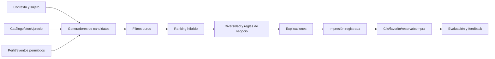

# Recomendaciones, outfits y personalización

**Estado:** diseño progresivo; no implementado  
**Restricción actual:** solo 5 favoritos, 2 usuarios con favoritos y 1 venta identificada

## 1. Objetivo

El dominio recomienda opciones disponibles y explica por qué. No existe un único recomendador: similares, complementos, última compra, reposición personal y outfits optimizan intenciones distintas.

| Intención | Ejemplo | Señal principal |
|---|---|---|
| Similar | «más prendas como esta» | embedding/atributos/categoría |
| Complementaria | «qué combina con este pantalón» | roles, reglas, compra conjunta futura |
| Última compra | «completa tu compra reciente» | último ítem + ventana + stock |
| Perfil | «selección para este cliente» | historial, favoritos, eventos y restricciones |
| Ocasión/estilo | «outfit casual de invierno» | taxonomía + reglas + ranking |
| Reposición personal | «vuelve a comprar un básico» | consumo repetible y tiempo; no aplica a toda moda |

KNN puede recuperar vecinos similares; no decide que dos prendas forman un conjunto. KNN es una señal de candidatos, no una red neuronal ni una regla estética.

## 2. Estado real y consecuencia

Con los datos actuales no es posible entrenar filtrado colaborativo, secuencias o learning-to-rank. Tampoco se conoce qué productos fueron mostrados e ignorados. El orden correcto es:

1. instrumentar eventos y taxonomía;
2. servir baselines no personales;
3. agregar similitud y reglas;
4. registrar exposición/clic/compra;
5. construir perfiles de contenido;
6. evaluar asociación/colaborativo cuando haya soporte.

La primera versión debe ser útil aun para usuario anónimo y catálogo pequeño.

## 3. Arquitectura del recomendador



### 3.1 Generadores de candidatos

- popularidad elegible por ventana y ubicación;
- novedades con control de catálogo;
- similitud por embedding/atributos;
- misma categoría/estilo/marca/rango de precio;
- matriz de complementos por rol;
- reglas de última compra;
- reglas de asociación cuando sean estables;
- perfil de contenido del cliente;
- colaborativo futuro.

Cada generador entrega `candidate_id`, `source`, `raw_score`, evidencia y versión. Se unen y deduplican antes de rankear.

### 3.2 Filtros duros

- estado publicable/activo;
- stock y ubicación elegible;
- talla/color solicitados cuando sean requisito;
- visibilidad/rol/autorización;
- excluir el mismo producto si la intención no permite repetición;
- presupuesto/precio cuando sea restricción;
- no usar atributos personales no consentidos;
- no recomendar artículos bloqueados o sin imagen aprobada.

### 3.3 Ranking

Score inicial explicable:

```text
rank_score = w_intent·intent_relevance
           + w_content·content_similarity
           + w_compat·complementarity
           + w_profile·profile_affinity
           + w_quality·catalog_quality
           + w_fresh·freshness
           + w_pop·bounded_popularity
           + w_business·approved_business_signal
           - penalties
```

Penalizaciones: duplicidad, indisponibilidad, precio fuera de rango, repetición excesiva, baja confianza, saturación de marca/categoría y datos incompletos. Margen puede ser una señal acotada y transparente, nunca dominar relevancia ocultamente.

### 3.4 Post-ranking

- diversidad de categoría/color/marca/precio;
- límite por familia/variante;
- novedad con exploración controlada;
- disponibilidad confirmada cerca de la respuesta;
- reason codes legibles;
- fallback si quedan pocos candidatos.

## 4. Estrategia progresiva

| Nivel | Estrategia | Entrenamiento propio | Compuerta |
|---|---|---|---|
| 1 | popularidad, novedades y reglas | no | catálogo/stock fiables |
| 2 | similares por atributos/embedding | no | embeddings y evaluación humana |
| 3 | última compra | no | compra identificada y ventana |
| 4 | perfil basado en contenido | no necesariamente | suficientes señales consentidas |
| 5 | cross-selling híbrido | no al inicio | matriz de roles; cestas después |
| 6 | híbrido reglas+contenido+asociación | puede calibrar pesos | estabilidad offline/online |
| 7 | learning-to-rank | sí | exposiciones y labels sin fuga |
| 8 | colaborativo/secuencial | sí | usuarios/eventos recurrentes y cobertura |

Deep learning no es un nivel de madurez por sí mismo. Solo entra si supera baselines y justifica costo/privacidad.

## 5. Productos similares

### 5.1 Vector de similitud

Combinar:

- embedding visual/multimodal;
- categoría/tipo compatibles;
- patrón, silueta, material confirmado y estilo;
- paleta y distancia de color;
- temporada/género según la política de catálogo;
- rango de precio, marca y novedad;
- stock.

No todos los atributos deben entrar como texto en el mismo embedding. Los filtros exactos y la similitud semántica se combinan explícitamente.

### 5.2 Búsqueda

Con 13 prendas se usa comparación exacta contra todas las embeddings. Añadir HNSW/IVFFlat perjudica simplicidad y puede reducir recall sin beneficio. Al crecer:

- medir latencia/recall de búsqueda exacta;
- evaluar pgvector para vectores junto a filtros y transacciones;
- comparar resultados aproximados contra exactos;
- versionar embedding y reindexar sin mezclar espacios incompatibles.

### 5.3 Evaluación

- precision@k según expertos/usuarios;
- tasa de candidatos elegibles;
- diversidad y cobertura de catálogo;
- estabilidad entre versiones;
- clic/favorito/reserva/compra después de registrar impresiones;
- tasa de corrección/rechazo del administrador en flujo de catálogo.

## 6. Última compra

### 6.1 Flujo

1. obtener última venta válida identificada, con autorización;
2. definir antigüedad y excluir anulaciones/devoluciones;
3. identificar roles y atributos comprados;
4. generar complementos, no meros duplicados;
5. filtrar stock/talla/precio;
6. rankear con perfil si existe;
7. explicar: «complementa tu pantalón de pinza»;
8. registrar exposición y outcome.

### 6.2 Ventanas y privacidad

La ventana depende de intención: complementos pueden ser relevantes días/semanas; reposición de básicos puede usar meses. Debe ser una regla de negocio versionada. No se muestra el historial en un dispositivo o sesión no autorizada.

Fallback:

- sin compra: favoritos recientes;
- sin favoritos: contexto actual;
- anónimo: popularidad/novedad por contexto;
- compra demasiado antigua: perfil agregado o baseline.

## 7. Cross-selling

### 7.1 Inicio por reglas

Matriz conceptual, revisada por negocio:

| Rol origen | Roles complemento candidatos |
|---|---|
| `top` | `bottom`, `outerwear`, `accessory` |
| `bottom` | `top`, `outerwear`, `accessory` |
| `one_piece` | `outerwear`, `accessory` |
| `outerwear` | `top`, `bottom`, `one_piece`, `accessory` |
| `accessory` | cualquier rol compatible |
| `footwear`/`bag` | solo si el catálogo realmente los incorpora |

La matriz establece roles posibles, no compatibilidad final.

### 7.2 Asociación futura

Apriori/FP-Growth aportan `support`, `confidence` y `lift` cuando existen muchas cestas. Requisitos:

- ventana y unidad de cesta definidas;
- soporte absoluto mínimo, no solo porcentaje;
- evaluación por períodos y no un único dataset;
- controlar promociones/combos que causaron la asociación;
- filtrar por stock y semántica de rol;
- conservar reglas curadas como fallback.

Las 11 ventas actuales no cumplen la compuerta.

## 8. Outfits

### 8.1 Definición

Un outfit es un conjunto ordenado de roles, no una lista de vecinos. Debe cumplir:

- roles no conflictivos;
- compatibilidad de categoría y silueta;
- armonía/contraste de color;
- coherencia de temporada, ocasión y estilo;
- presupuesto y stock;
- talla cuando aplique;
- preferencias/restricciones del cliente;
- diversidad frente a conjuntos ya mostrados.

Taxonomías ausentes que bloquean un outfit fuerte: rol, ocasión, estilo, patrón, silueta, material confirmado y reglas de capas.

### 8.2 Generación progresiva

**Fase 1 — plantillas curadas**

```text
bottom → top → optional outerwear → optional accessory
one_piece → optional outerwear → optional accessory
top → bottom → optional accessory
```

**Fase 2 — ranking de combinaciones**

```text
compatibility = role_validity
              + color_harmony
              + occasion_match
              + style_match
              + seasonal_fit
              + customer_affinity
              + basket_evidence
              - conflict/risk
```

**Fase 3 — beam search acotado**

- expandir por rol pendiente;
- conservar solo top-B estados;
- podar por stock, presupuesto y conflictos;
- limitar número de prendas y variantes;
- diversificar resultados finales.

El beam search es una estrategia combinatoria; no implica deep learning.

### 8.3 Color

Inicio con reglas versionadas sobre paleta: monocromático, análogo, complementario, neutro+acento y contraste permitido. Estas reglas son preferencias culturales/comerciales, no verdades universales. El administrador puede corregir y el cliente puede seleccionar estilo de combinación.

### 8.4 Embeddings

La similitud ayuda a mantener estilo; la complementariedad requiere señales distintas. Dos tops muy cercanos en embedding probablemente sean sustitutos, no piezas para el mismo outfit. Por eso:

- embeddings generan/coherencian candidatos dentro de un rol;
- matriz de roles evita sustitutos incompatibles;
- reglas y asociación aportan complementariedad;
- ranking combina señales y muestra explicación.

### 8.5 Salida

```json
{
  "outfits": [
    {
      "items": [{"product_id": 0, "role": "bottom"}],
      "score": 0.0,
      "reasons": [],
      "constraints_satisfied": [],
      "warnings": [],
      "total_price": 0,
      "currency": "BOB"
    }
  ],
  "fallback_used": false,
  "human_or_customer_choice_required": true
}
```

## 9. Perfil de contenido

Representación progresiva:

- pesos por categoría, color, marca, estilo, talla y precio;
- embeddings agregadas de eventos positivos con decaimiento temporal;
- señales negativas solo si hubo exposición válida;
- preferencias explícitas pesan más que inferencias débiles;
- contexto actual puede sobreescribir temporalmente el perfil.

Pesos de evento conceptuales, por validar: compra > reserva completada > favorito > clic > vista. Una reserva cancelada no siempre es señal negativa; puede deberse a pago/stock. Un producto mostrado sin clic solo es negativo muy débil y requiere registrar posición/tiempo.

El perfil almacena derivaciones mínimas y versionadas. El cliente debe poder solicitar borrado/opt-out según política aplicable.

## 10. Eventos necesarios

### 10.1 Esquema conceptual

```json
{
  "event_id": "uuid",
  "occurred_at": "...",
  "actor_id": null,
  "anonymous_session_id": "rotating-token",
  "event_type": "recommendation_impression",
  "product_id": 0,
  "variant_id": null,
  "context": "product_detail",
  "placement": "similar_products",
  "position": 1,
  "recommendation_request_id": "uuid",
  "strategy_id": "content-v1",
  "metadata": {}
}
```

Eventos mínimos:

- `product_view` y `search`/`search_no_result`;
- `recommendation_impression` por producto/posición;
- `recommendation_click`;
- `favorite_added/removed`;
- `reservation_started/completed/cancelled`;
- `purchase_completed/voided/returned` cuando exista semántica;
- `outfit_viewed/item_selected`;
- `feedback_positive/negative` explícito.

### 10.2 Reglas de instrumentación

- evento idempotente;
- event time y server received time;
- consentimiento/propósito y retención;
- no guardar texto libre sensible innecesario;
- bots/admin/test excluidos o marcados;
- una impresión significa que el elemento era visible/elegible, no solo que fue generado;
- vincular conversión mediante ventana atribuible, sin afirmar causalidad.

## 11. Cold start

### 11.1 Usuario nuevo/anónimo

- contexto actual, categoría, ubicación y temporada;
- popularidad con ventana y stock;
- novedades y exploración diversa;
- preferencias explícitas opcionales;
- sin fingerprinting ni atributos sensibles.

### 11.2 Producto nuevo

- atributos confirmados y embedding de imagen aprobada;
- reglas de rol/ocasión;
- exploración limitada para obtener exposición;
- no penalizarlo por no tener clics antes de ser mostrado.

### 11.3 Catálogo pequeño

- búsqueda exacta;
- plantillas de outfits;
- popularidad acotada para evitar bucles;
- curación humana de compatibilidades.

## 12. Evaluación offline

División temporal por fecha; nunca mezclar interacciones futuras en el perfil. Métricas:

- Recall@K, Precision@K, MAP/NDCG@K;
- MRR para similar/búsqueda;
- cobertura de catálogo y usuario;
- diversidad, novedad y serendipia definida;
- disponibilidad/tasa de filtrado;
- calibración por categoría/precio;
- métricas por cold start y frecuencia;
- popularidad como baseline obligatorio.

Las compras no expuestas no son negatives válidos para ranking. Se necesita logging de impresiones y, para contrafactual futuro, políticas de exploración controlada.

## 13. Evaluación online

Primero shadow/logging; después A/B cuando haya tráfico:

- CTR por impresión visible;
- favorito/reserva/compra atribuida;
- unidades por cesta, ingreso y margen con guardrails;
- cancelaciones/devoluciones futuras;
- diversidad y cobertura;
- latencia y errores;
- opt-out/feedback negativo;
- impacto por segmento sin discriminación.

No optimizar solo CTR: títulos llamativos o productos agotados pueden recibir clics sin valor. Venta y satisfacción tienen demora; deben medirse por ventana.

## 14. Explicaciones

Reason codes controlados:

- `similar_style`, `similar_color`, `same_category`;
- `complements_last_purchase`;
- `commonly_bought_together` solo con soporte mostrado internamente;
- `fits_selected_occasion`, `within_budget`;
- `popular_in_location`, `new_arrival`;
- `based_on_favorites` con consentimiento.

No usar explicaciones generadas que afirmen causalidad inexistente. Una explicación debe derivar de features realmente usadas.

## 15. Privacidad y control

- minimización, propósito y retención para eventos/perfiles;
- separar actor autenticado de sesión anónima rotatoria;
- no usar medidas corporales, foto VTO o OCR de cliente para recomendación general;
- exportación/borrado/opt-out según política aprobada;
- no inferir género, edad, etnia, salud ni nivel socioeconómico;
- acceso por rol y auditoría de perfiles internos;
- evitar que un vendedor vea historia no necesaria;
- entrenamiento futuro usa datasets aprobados y seudonimizados.

## 16. Criterios de activación por nivel

1. Catálogo, stock y taxonomías confiables.
2. Baseline/fallback operativo.
3. Eventos de impresión y outcome validados.
4. Evaluación temporal contra popularidad.
5. Explicaciones correctas y filtros de stock/talla.
6. Métricas de diversidad y no solo conversión.
7. Privacidad/opt-out aprobados.
8. Colaborativo/LTR solo con cobertura y mejora objetiva.

## 17. Primer producto recomendable

Para el estado actual:

- página de producto: top-k similares por categoría+embedding, búsqueda exacta;
- carrito/venta: complementos por matriz de roles curada;
- usuario identificado: última compra solo cuando exista y sea reciente;
- outfits: plantillas curadas después de crear roles/ocasión/estilo;
- fallback: novedades/popularidad elegible;
- logging de impresión/clic desde el primer día.

Este diseño entrega valor sin fingir personalización que los datos todavía no permiten.
