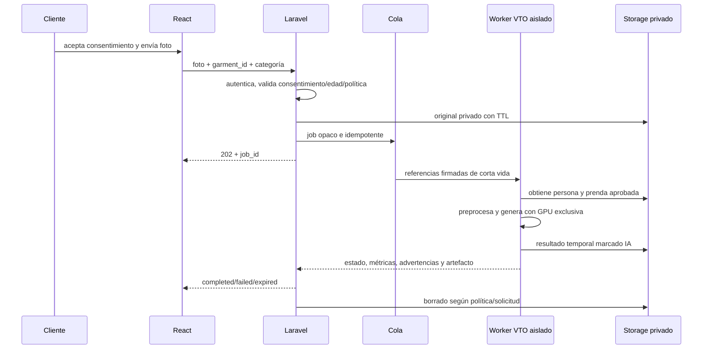

# Virtual try-on y recomendación de talla

**Estado:** investigación y arquitectura experimental; no implementado  
**Hardware objetivo a validar:** NVIDIA RTX 5060 con 8 GB de VRAM  
**Fecha de consulta de repositorios/licencias:** 2026-08-03

## 1. Dos productos diferentes

| Módulo | Pregunta | Resultado | No garantiza |
|---|---|---|---|
| Virtual try-on (VTO) | «¿Cómo podría verse esta prenda sobre esta foto?» | imagen sintética aproximada | talla, medidas, caída real, color/detalles exactos |
| Talla y ajuste | «¿Qué talla tiene mayor probabilidad de ajustarse como prefiero?» | ranking/regla con evidencia | certeza sin tabla, medidas y feedback |

No se usa el VTO para inferir talla. No se afirma talla correcta basándose solo en una fotografía. La visualización puede alterar logos, texturas, estampado, partes del cuerpo y corte; debe mostrarse junto con advertencia y acceso a la foto de producto aprobada.

## 2. Evaluación de modelos VTO

No se descargaron pesos ni se ejecutó ningún modelo. Los valores publicados no sustituyen un benchmark local.

| Modelo | Licencia publicada | Pesos/cadena | Máscara/pose | Categorías/resolución | 8 GB y mantenimiento | Decisión V2 |
|---|---|---|---|---|---|---|
| [CatVTON](https://github.com/Zheng-Chong/CatVTON) | CC BY-NC-SA 4.0 para código, checkpoints y demo | checkpoints públicos; basado en diffusion/inpainting | app usa SCHP/DensePose; modelo simplifica inferencia | repo declara 1024×768 y `<8G`/aprox. 8 GB con bf16 | repo activo hasta updates 2025; Python 3.9 publicado; claim oficial de VRAM, no medido en 5060 | bloqueado para uso comercial por `NC`; solo investigación autorizada |
| [IDM-VTON](https://github.com/yisol/IDM-VTON) | CC BY-NC-SA 4.0 para código y checkpoints | múltiples componentes/checkpoints | DensePose, human parsing y OpenPose en demo | VITON-HD/DressCode; repo no promete perfil oficial simple de 8 GB | mantenimiento/requisitos antiguos; claims de 8 GB en issues externos no son SLO oficial | bloqueado comercialmente; no default |
| [StableVITON](https://github.com/rlawjdghek/StableVITON) | CC BY-NC-SA 4.0 | pesos y dependencias publicadas | preprocesamiento/pose/parsing según pipeline | orientado a VITON-HD | stack publicado antiguo y sin perfil 8 GB garantizado | bloqueado comercialmente |
| [OOTDiffusion](https://github.com/levihsu/OOTDiffusion) | CC BY-NC-SA 4.0 | checkpoints OOTD + parsing + OpenPose + CLIP | parsing/pose; pipeline multi-componente | upper, lower y dress; half/full body | probado por autores en Ubuntu 22.04 con stack fijado; VRAM/latencia 8 GB no garantizadas | bloqueado comercialmente |
| [FASHN VTON v1.5](https://github.com/fashn-AI/fashn-vton-1.5) | Apache-2.0 en repositorio | pesos ~2 GB + DWPose; parser adicional según README | maskless para usuario, usa pose y parser internos | tops, bottoms, one-pieces; flat-lay o model photo | publicación 2026, bf16 en Ampere+; README no garantiza 8 GB ni latencia | **candidato técnico/legal principal**, sujeto a auditoría de todos los pesos/dependencias y benchmark local |
| API VTO comercial | contrato del proveedor | servicio administrado | oculto/proveedor | según SLA | evita VRAM local; agrega costo, red y dependencia | alternativa buy-vs-build si DPA, región, borrado y derechos se aprueban |

### 2.1 Lectura crítica

- CatVTON es el único de los cuatro modelos académicos comparados que publica explícitamente un perfil cercano a 8 GB para 1024×768, pero su licencia no comercial impide el uso de boutique sin licencia adicional.
- IDM-VTON, StableVITON y OOTDiffusion también usan CC BY-NC-SA 4.0. Tener el repositorio público no autoriza explotación comercial.
- FASHN VTON v1.5 publica Apache-2.0 y una cadena más contenida, por lo que merece un spike futuro. Aun así, deben auditarse licencias/condiciones de cada peso auxiliar y dataset, compatibilidad CUDA/driver, memoria pico y fidelidad en prendas Mati.
- La licencia del código no prueba que todos los checkpoints, datasets, marcas o inputs estén libres de otras restricciones. Revisión jurídica final es obligatoria.
- Una API externa puede tener licencia comercial clara, pero enviaría imágenes personales a un tercero; privacidad, país/región, subprocesadores, entrenamiento, retención y borrado se vuelven compuertas.

## 3. Requisitos de evaluación objetiva

### 3.1 Dataset de prueba autorizado

- fotos de adultos voluntarios con consentimiento específico;
- productos propios con imagen aprobada y categorías representativas;
- variación de pose, cuerpo, fondo, iluminación y capas;
- pares con tops, bottoms y one-pieces;
- casos difíciles/negativos y opt-out;
- sin reutilizar datasets no comerciales para evaluación productiva si sus términos lo prohíben.

El dataset de QA no se usa para entrenar salvo consentimiento y aprobación separados.

### 3.2 Métricas técnicas

- pico de VRAM/RAM y tiempo de carga;
- latencia p50/p95 por resolución/categoría;
- tasa de OOM, fallo de pose/parsing y job incompleto;
- resolución efectiva y tamaño de artefacto;
- fidelidad de prenda: color, patrón, logo, cuello, mangas y silueta;
- preservación de identidad/apariencia sin evaluar biometría;
- artefactos anatómicos, oclusiones y cambio de fondo/cuerpo;
- estabilidad entre semillas/opciones;
- evaluación humana ciega y razón de rechazo.

Métricas perceptuales automáticas pueden acompañar, pero no sustituyen revisión de fidelidad comercial.

### 3.3 Compuerta de producto

No activar VTO hasta que:

1. licencia de código, pesos y auxiliares esté aprobada para uso comercial;
2. el modelo funcione de forma estable en 8 GB o exista presupuesto de infraestructura/API;
3. privacidad, consentimiento, retención y borrado estén implementados y probados;
4. categoría/foto elegibles estén definidas;
5. se muestre una advertencia inequívoca y marca de IA;
6. la tasa de resultados engañosos esté debajo del umbral aprobado;
7. exista mecanismo para reportar/borrar resultado;
8. el flujo manual de compra no dependa del job.

## 4. Arquitectura asíncrona



### 4.1 Estados

`pending_consent`, `queued`, `running`, `completed`, `completed_with_warnings`, `failed`, `cancelled`, `expired`, `deletion_pending`, `deleted`.

Transiciones son controladas por Laravel. El worker no puede reabrir un job borrado ni prolongar TTL.

### 4.2 Idempotencia

La clave conceptual incluye actor autorizado, hash de inputs, garment asset/version, categoría, perfil/modelo y una ventana. Reintentar no crea resultados ilimitados. Se fija máximo de intentos y errores no reintentables (`invalid_image`, `consent_revoked`, `unsupported_category`, `license_disabled`).

### 4.3 Payload mínimo al worker

Permitido:

- `job_id` opaco;
- URLs firmadas cortas a foto y activo de prenda;
- categoría `tops|bottoms|one_pieces` validada;
- versión de modelo/perfil;
- configuración técnica limitada;
- `delete_after`.

Nunca recibe nombre, CI, teléfono, correo, dirección, historial, pagos, medidas o notas del cliente.

## 5. Aislamiento de GPU

La RTX 5060 de 8 GB se trata como recurso de exclusión mutua:

- concurrencia VTO = 1 hasta medir;
- proceso/worker diferente del modelo SigLIP/CLIP;
- descarga completa de modelos visuales antes de VTO;
- arranque bajo demanda o ventana planificada;
- límite de resolución y pasos fijado por perfil;
- no generar cuatro muestras por defecto si una satisface producto;
- bf16/fp16, atención eficiente, VAE tiling/slicing, cuantización y CPU offload se evalúan individualmente;
- medir impacto de offload en latencia/RAM/PCIe y fidelidad;
- healthcheck de API independiente del worker;
- circuit breaker tras OOM repetido y limpieza explícita del proceso.

No se promete que FASHN VTON v1.5 funcione dentro de 8 GB hasta medirlo. Si no cumple, alternativas: resolución menor aprobada, offload medido, GPU dedicada mayor o API con contrato.

## 6. Preprocesamiento y elegibilidad

### 6.1 Foto de persona

- una sola persona adulta y con consentimiento;
- cuerpo/área requerida visible según categoría;
- postura y manos no ocultan excesivamente la zona;
- iluminación/resolución mínimas;
- ropa base y fondo según guía del modelo;
- orientación correcta;
- sin desnudez ni contenido prohibido;
- EXIF removido en copia; ubicación nunca necesaria;
- no se ejecuta reconocimiento facial ni identificación.

No se estima edad automáticamente. El cumplimiento para menores requiere política y mecanismo de autorización aprobados; hasta entonces, el producto se limita a adultos declarados.

### 6.2 Imagen de prenda

- derivado aprobado y con derechos;
- una prenda, categoría compatible y fondo adecuado;
- color/patrón fieles y resolución suficiente;
- versión/hash asociado al producto;
- no usar candidato externo no aprobado.

### 6.3 Salida

- imagen marcada/overlay «Visualización generada por IA»;
- enlace a producto real y fotos originales;
- advertencias de fidelidad/ajuste;
- modelo/perfil y seed internos auditables, no necesariamente expuestos completos;
- TTL y botón de borrar/reportar;
- prohibición de sustituir la imagen de catálogo sin otro proceso de aprobación.

## 7. Privacidad y seguridad de VTO

### 7.1 Consentimiento

Consentimiento explícito, granular y versionado para:

- procesar la foto con propósito VTO;
- indicar local o tercero y sus condiciones;
- retención máxima y borrado;
- mostrar que el resultado es sintético;
- uso opcional para mejora/entrenamiento como consentimiento **separado**, desactivado por defecto.

Revocar impide nuevos procesos y programa borrado según obligaciones aplicables. Un cambio de modelo/proveedor que materialmente cambie el tratamiento exige revisar consentimiento.

### 7.2 Minimización y retención

- storage privado cifrado y URLs firmadas cortas;
- originales/resultados con TTL breve configurable, no conservación indefinida;
- cache de modelo no contiene fotos;
- temporales del worker se limpian al final y al arrancar;
- logs sin binarios, rutas firmadas, caras, OCR o prompts personales;
- backups y CDN deben respetar borrado/expiración documentada;
- auditoría guarda IDs, estado y hashes mínimos, no la imagen tras borrado.

El plazo exacto (por ejemplo, horas o pocos días) es una decisión de producto/legal; V2 recomienda el mínimo compatible con notificación y soporte.

### 7.3 Prohibiciones

- reconocimiento/identificación facial;
- extracción de etnia, salud, discapacidad, edad, emoción u otros atributos sensibles;
- reutilización para publicidad o entrenamiento sin nuevo permiso;
- compartir con un proveedor no declarado;
- usar el resultado para negar venta/precio/servicio;
- indexar fotos de clientes en búsqueda visual del catálogo;
- prompts abiertos que permitan sexualización, suplantación o edición no relacionada.

## 8. Riesgos de calidad VTO

| Riesgo | Mitigación |
|---|---|
| Cambia logo/patrón/color | comparación visual, advertencia, limitar categorías/modelos y mostrar original |
| Altera cuerpo/rostro | preservar input, revisión QA, reporte y bloqueo de modelo |
| Oclusiones/manos/cabello | elegibilidad y rechazo temprano |
| Mala pose/parsing | `failed_preprocessing`, guía para nueva foto |
| Sugiere ajuste falso | separar módulo de talla y texto explícito |
| OOM/latencia | worker exclusivo, cola, perfil bajo, circuit breaker |
| Licencia incompatible | registry bloquea modelo por licencia |
| Foto personal filtrada | storage privado, mínimo acceso, TTL y logs seguros |
| Dependencia externa | DPA/SLA/fallback y portabilidad de jobs |
| Contenido ofensivo | filtros de entrada/salida y reporte humano |

## 9. Recomendación de talla y ajuste

### 9.1 Datos potenciales

- tabla de tallas por marca, línea, género comercial y tipo de prenda;
- medidas reales de la prenda por variante/lote;
- elasticidad, corte y tolerancias;
- medidas del cliente relevantes a la prenda;
- altura y peso solo si el método los necesita, con propósito y opcionalidad;
- preferencia `ajustado|regular|holgado`;
- talla que funcionó antes por marca/categoría;
- cambios/devoluciones y razón de ajuste;
- feedback explícito `pequeña|correcta|grande`.

Hoy ninguno de estos datos existe de forma estructurada, salvo talla de variante. Por tanto, no se puede activar recomendación individual responsable.

### 9.2 Estrategia progresiva

**Nivel 1 — tabla y reglas**

- seleccionar tabla exacta por marca/línea/tipo;
- comparar medidas requeridas;
- aplicar holgura y preferencia;
- devolver tallas compatibles/rango y datos faltantes;
- abstener si la tabla es genérica o contradictoria.

**Nivel 2 — perfil de medidas**

- medidas consentidas, fecha y método de captura;
- detectar valores imposibles/unidades;
- permitir múltiples perfiles/versiones;
- no reutilizar para segmentación comercial.

**Nivel 3 — historial personal**

- priorizar mismo producto/tabla/marca/corte;
- tratar devolución/cambio con razón;
- decaimiento si medidas/perfil cambiaron;
- explicar la evidencia.

**Nivel 4 — ranking supervisado**

Features: diferencia prenda-cuerpo, elasticidad/corte, marca, categoría, preferencia e historial. Objetivo: probabilidad por talla y outcome de ajuste, no solo compra.

**Nivel 5 — probabilístico**

Solo con suficiente feedback/devoluciones, intervalos y calibración por grupo de producto. Debe informar incertidumbre y opción de dos tallas cuando corresponda.

### 9.3 Regla conceptual

```text
required_ease = rule(category, material, cut, fit_preference)
garment_fit_margin = garment_measurement - body_measurement
compatibility = within_tolerance(garment_fit_margin, required_ease)
```

Para prendas elásticas y medidas de cuerpo/prenda se usan reglas diferentes. No se comparan directamente sin definir si una medida es contorno corporal, prenda plana o prenda extendida.

### 9.4 Respuesta responsable

```json
{
  "recommendations": [
    {"size_id": 0, "label": "M", "probability": null, "fit": "regular"}
  ],
  "basis": ["brand_size_chart", "explicit_measurements"],
  "missing_data": [],
  "warnings": ["approximation_not_guarantee"],
  "abstained": false,
  "model_or_rule_version": "fit-rules-v1"
}
```

Si no hay tabla exacta o medidas suficientes, `abstained: true`. Una tabla de otra marca no se usa silenciosamente.

## 10. Privacidad de tallas

- medidas son datos personales con acceso limitado y propósito específico;
- recoger solo medidas necesarias por categoría;
- peso/altura opcionales y con explicación de uso;
- permitir actualizar, borrar y revocar;
- cifrado y auditoría de acceso;
- no mostrar medidas a personal que solo necesita la talla recomendada;
- no inferir salud, embarazo, discapacidad o identidad;
- no combinar medidas con anuncios/precios sin consentimiento válido;
- no almacenar una «forma corporal» derivada de foto como atajo.

## 11. Evaluación de talla

- cobertura: proporción con datos suficientes;
- top-1/top-2 accuracy contra feedback real;
- log loss/Brier y calibración por probabilidad;
- tasa de cambio/devolución por razón de talla;
- recomendación demasiado pequeña/grande y sesgo;
- resultados por marca, categoría, corte y elasticidad;
- abstención correcta cuando faltan datos;
- comparación contra tabla simple.

La compra de una talla no es automáticamente una etiqueta de buen ajuste. Se necesita feedback o ausencia de devolución dentro de una ventana, con cautela.

## 12. Roadmap específico

1. Definir política de consentimiento/retención y adultos.
2. Crear guía de fotos y activos de prenda elegibles.
3. Auditar FASHN VTON v1.5 y alternativas comerciales, incluidas dependencias/pesos.
4. Ejecutar spike aislado futuro en hardware real con dataset autorizado.
5. Decidir local frente a API mediante calidad, costo y privacidad.
6. Implementar job asíncrono, borrado y observabilidad antes de UI pública.
7. Piloto interno/voluntario, categorías limitadas y watermark.
8. Activar cliente solo tras compuertas.
9. En paralelo, recopilar tablas/medidas de prenda para talla basada en reglas.
10. Modelos de talla solo tras feedback suficiente.

## 13. Decisión recomendada hoy

- **No implementar VTO dentro de MVP1–MVP4.**
- **Bloquear CatVTON, IDM-VTON, StableVITON y OOTDiffusion para uso comercial** salvo licencia adicional por escrito.
- **Mantener FASHN VTON v1.5 como candidato de spike**, no como promesa de producto; verificar todos los componentes y 8 GB.
- **Priorizar talla por tabla/medidas** antes de cualquier inferencia fotográfica.
- **Separar presupuesto/worker VTO** del pipeline visual del catálogo.

## 14. Fuentes primarias

- [CatVTON — repositorio y licencia](https://github.com/Zheng-Chong/CatVTON)
- [IDM-VTON — repositorio y licencia](https://github.com/yisol/IDM-VTON)
- [StableVITON — repositorio y licencia](https://github.com/rlawjdghek/StableVITON)
- [OOTDiffusion — repositorio](https://github.com/levihsu/OOTDiffusion)
- [OOTDiffusion — licencia](https://github.com/levihsu/OOTDiffusion/blob/main/LICENSE)
- [FASHN VTON v1.5 — repositorio](https://github.com/fashn-AI/fashn-vton-1.5)
- [FASHN VTON v1.5 — licencia Apache-2.0](https://github.com/fashn-AI/fashn-vton-1.5/blob/main/LICENSE)
