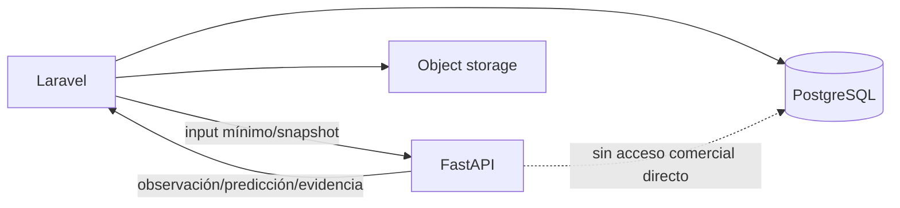

# Contratos API y datos V2

**Estado:** contratos conceptuales; no implementados  
**Regla de autoridad:** React → Laravel → FastAPI. Laravel autentica, autoriza y persiste; FastAPI no escribe tablas comerciales.

## 1. Compatibilidad con V1

Los contratos de análisis visual, health/readiness y feedback propuestos en V1 se conservan conceptualmente. V2 agrega endpoints por dominio y un sobre común. La versión `/api/v1` no garantiza que todos se implementen a la vez; la fase y capability discovery determinan disponibilidad.

El cliente público no debe recibir la URL ni el token internos de FastAPI. Laravel traduce IDs comerciales a payloads mínimos y valida el resultado antes de mostrarlo o persistirlo.

## 2. Sobre común

### 2.1 Solicitud

Headers conceptuales:

```http
Authorization: Bearer <service-token>
X-Request-Id: <uuid>
X-Correlation-Id: <uuid>
Idempotency-Key: <opaque-key>   # obligatorio cuando crea job/artefacto
X-Contract-Version: 1
```

- token de servicio de alcance mínimo; no token de usuario final;
- Laravel transmite un `actor_context` opaco solo si el caso lo necesita;
- deadline explícito y límite de payload;
- archivos mediante multipart controlado o referencias firmadas; nunca rutas del filesystem proporcionadas por cliente.

### 2.2 Respuesta síncrona

```json
{
  "request_id": "uuid",
  "contract_version": "1",
  "status": "completed",
  "data": {},
  "warnings": [],
  "abstentions": [],
  "model": {
    "id": "deterministic-or-model-id",
    "version": "...",
    "pipeline_version": "..."
  },
  "timing_ms": {"total": 0},
  "human_review_required": true
}
```

Estados: `completed`, `partial`, `insufficient_evidence`, `degraded`, `failed`. `partial` nunca se interpreta como éxito completo.

### 2.3 Respuesta asíncrona

```json
{
  "request_id": "uuid",
  "job_id": "opaque-uuid",
  "status": "queued",
  "status_url": "/api/v1/.../jobs/opaque-uuid",
  "expires_at": "..."
}
```

Laravel es dueño del job comercial. FastAPI/worker puede usar un ID de ejecución técnico correlacionado, pero no expone rutas internas ni decide retención.

## 3. Autenticación, idempotencia y timeout

| Clase | Autenticación | Timeout/deadline inicial | Idempotencia |
|---|---|---|---|
| Ligera síncrona | token interno + allowlist | 3–10 s según pipeline | `request_id`; recomendable por hash de input |
| Modelo síncrono | token interno + allowlist | 10–30 s; fallback | hash input+modelo+perfil |
| Fuente externa | token interno, fuente con su credencial | HTTP inicial devuelve en ≤10 s; job tiene TTL | obligatoria por consulta/fuente/ventana |
| Batch comercial | token interno + rol/orquestación Laravel | 202 rápido; deadline del job por política | snapshot+parámetros+modelo |
| VTO | token interno + consentimiento validado | 202 rápido; job con TTL y sin espera HTTP | actor+hash inputs+modelo+perfil |

Los números son presupuestos iniciales para diseño, no SLO confirmado. Deben ajustarse mediante medición.

## 4. Catálogo de errores

```json
{
  "request_id": "uuid",
  "status": "failed",
  "error": {
    "code": "INVALID_IMAGE",
    "message": "La imagen no cumple el contrato.",
    "retryable": false,
    "details": {"field": "image", "reason": "..."}
  }
}
```

Familias:

- `INVALID_REQUEST`, `UNSUPPORTED_MEDIA`, `PAYLOAD_TOO_LARGE`, `DECODE_FAILED`;
- `UNAUTHORIZED_SERVICE`, `FORBIDDEN_CAPABILITY`, `CONSENT_REQUIRED`;
- `INSUFFICIENT_EVIDENCE`, `INSUFFICIENT_HISTORY`, `MISSING_REQUIRED_DATA`;
- `MODEL_UNAVAILABLE`, `GPU_BUSY`, `GPU_OOM`, `PIPELINE_TIMEOUT`;
- `SOURCE_UNAVAILABLE`, `SOURCE_RATE_LIMITED`, `SOURCE_TERMS_BLOCKED`;
- `UNSAFE_REMOTE_URL`, `RIGHTS_NOT_APPROVED`;
- `CONFLICTING_IDENTIFIER`, `UNREADABLE_CODE`, `UNMAPPED_VALUE`;
- `JOB_NOT_FOUND`, `JOB_EXPIRED`, `JOB_CANCELLED`;
- `INTERNAL_ERROR` sin stack trace al cliente.

## 5. Matriz de endpoints

| Endpoint | Fase | Modalidad | Técnica/modelo inicial | Persistencia |
|---|---:|---|---|---|
| `POST /api/v1/identification/barcode` | IA-6 | síncrona | OpenCV + checksum; ZXing futuro | Laravel |
| `POST /api/v1/identification/label` | IA-6 | síncrona acotada | Tesseract baseline + reglas | Laravel |
| `POST /api/v1/products/external-search` | IA-8 | asíncrona preferida | adaptadores + ranking | Laravel |
| `POST /api/v1/products/match` | IA-7/8 | síncrona | códigos + texto + embedding | Laravel |
| `POST /api/v1/images/prepare-publication` | IA-9 | asíncrona | pipeline determinista | Laravel/storage |
| `POST /api/v1/trends/analyze` | IA-13 | asíncrona/batch | score por reglas | Laravel |
| `POST /api/v1/commercial/patterns` | IA-10 | asíncrona/batch | SQL/reglas; FP-Growth futuro | Laravel |
| `POST /api/v1/commercial/demand/forecast` | IA-11 | asíncrona | naive/intermitente según compuerta | Laravel |
| `POST /api/v1/commercial/replenishment/suggest` | IA-12 | asíncrona | cobertura/min-max/ROP | Laravel |
| `POST /api/v1/commercial/assortment/suggest` | IA-14 | asíncrona | score multicriterio | Laravel |
| `POST /api/v1/recommendations/last-purchase` | IA-16 | síncrona | reglas + contenido | Laravel registra impresión |
| `POST /api/v1/recommendations/cross-sell` | IA-16 | síncrona | matriz de roles | Laravel registra impresión |
| `POST /api/v1/recommendations/outfits` | IA-17 | síncrona acotada | plantillas + ranking | Laravel registra impresión |
| `POST /api/v1/virtual-try-on/jobs` | IA-19 | asíncrona obligatoria | modelo aún no aprobado | Laravel/storage privado |
| `GET /api/v1/virtual-try-on/jobs/{id}` | IA-19 | síncrona de estado | sin inferencia | Laravel proxy/autoriza |
| `POST /api/v1/sizing/recommend` | IA-20 | síncrona | tablas + reglas | Laravel |

## 6. Contratos por endpoint

### 6.1 `POST /api/v1/identification/barcode`

- **Entrada:** una imagen dedicada o referencia firmada; simbologías permitidas opcionales; contexto de proveedor opcional.
- **Respuesta:** códigos detectados con región, simbología, valor bruto/normalizado, checksum, estado, candidatos internos suministrados por Laravel o solicitud de búsqueda externa.
- **Timeout:** 5 s inicial; no espera una fuente externa.
- **Idempotencia:** hash de imagen + versión de pipeline.
- **Errores específicos:** `UNREADABLE_CODE`, `CONFLICTING_IDENTIFIER`, `UNSUPPORTED_SYMBOLOGY`.
- **Privacidad:** EXIF no se devuelve; imagen temporal con TTL.
- **Nunca recibe:** datos de cliente, ventas, token externo ni acceso DB.
- **Persistencia:** Laravel decide asociar identificador a variante tras revisión.

### 6.2 `POST /api/v1/identification/label`

- **Entrada:** fotos específicas de etiqueta, idioma/país opcional y catálogos permitidos de marcas/tallas suministrados como IDs/valores mínimos.
- **Respuesta:** regiones y candidatos para marca, talla, composición, cuidado, modelo, SKU/GTIN; texto bruto, normalizado, confianza y advertencias.
- **Timeout:** 15 s inicial; respuesta parcial permitida.
- **Idempotencia:** hashes ordenados + pipeline.
- **Errores:** `NO_TEXT_REGION`, `UNMAPPED_VALUE`, `LOW_OCR_CONFIDENCE` como abstención, no 500.
- **Privacidad:** no OCR general de personas/documentos; temporales eliminados.
- **Nunca recibe:** documentos de identidad, notas médicas, información de pago.
- **Persistencia:** Laravel guarda sugerencia y confirmación por separado; no crea catálogos automáticamente.

### 6.3 `POST /api/v1/products/external-search`

- **Entrada:** consulta estructurada (GTIN, proveedor/modelo, marca, texto), embedding/ref de foto opcional, fuentes autorizadas, límite y región.
- **Respuesta:** job o top-k normalizado con fuente, URL canónica, códigos, metadatos, imágenes, similitudes, derechos y advertencias.
- **Timeout:** 202 en ≤10 s; deadline/TTL de job por fuente.
- **Idempotencia:** consulta canónica + fuentes + fecha/ventana + versión.
- **Errores:** rate limit/terms/source/untrusted URL; resultado parcial por fuente.
- **Privacidad:** consultas sin datos de cliente; fetch seguro anti-SSRF.
- **Nunca recibe:** URL arbitraria sin política, cookies del navegador, credenciales de fuente en payload.
- **Persistencia:** Laravel persiste candidatos/evidencia; binarios externos no aprobados expiran.

### 6.4 `POST /api/v1/products/match`

- **Entrada:** observaciones de códigos/OCR/atributos/embedding y candidatos internos/externos normalizados.
- **Respuesta:** ranking con componentes `code`, `brand`, `model`, `text`, `visual`, conflictos y abstención.
- **Timeout:** 10 s.
- **Idempotencia:** hashes de observaciones/candidatos + ranking_version.
- **Errores:** `CONFLICTING_IDENTIFIER`, `INSUFFICIENT_EVIDENCE`.
- **Privacidad:** no necesita actor/cliente.
- **Nunca recibe:** acceso a tablas, HTML crudo no sanitizado o imágenes personales.
- **Persistencia:** Laravel registra match propuesto y revisión.

### 6.5 `POST /api/v1/images/prepare-publication`

- **Entrada:** referencia firmada a activo aprobado, perfil (`thumbnail/card/detail`), rights approval ID y parámetros cerrados.
- **Respuesta:** manifiesto de derivados: dimensiones, formato, hash, tamaño, perfil/version y advertencias de fidelidad.
- **Timeout:** 202 si múltiples; síncrono solo para derivado pequeño bajo deadline medido.
- **Idempotencia:** hash original + perfil/version.
- **Errores:** `RIGHTS_NOT_APPROVED`, `COMMERCIAL_FIDELITY_RISK`, `DECODE_FAILED`.
- **Privacidad:** EXIF se elimina de derivados.
- **Nunca recibe:** prompt libre de edición, ruta arbitraria, candidato externo no aprobado.
- **Persistencia:** Laravel registra metadatos; objetos en storage, no PostgreSQL.

### 6.6 `POST /api/v1/trends/analyze`

- **Entrada:** snapshot normalizado externo/interno, taxonomía, región, períodos, pesos aprobados y fecha de corte.
- **Respuesta:** tendencia externa, demanda interna, alineación, oportunidad, riesgo, acciones y datos faltantes.
- **Timeout:** batch/202; cálculo puro puede ser síncrono si snapshot pequeño.
- **Idempotencia:** snapshot IDs + score_version.
- **Errores:** `INSUFFICIENT_SOURCE_COVERAGE`, `INCOMPARABLE_SCALE`, `STALE_SOURCE`.
- **Privacidad:** datos agregados; no posts/perfiles personales innecesarios.
- **Nunca recibe:** tokens de plataforma, fotos de clientes o PII de ventas.
- **Persistencia:** Laravel guarda score y evidencia; adaptadores ingieren por jobs controlados.

### 6.7 `POST /api/v1/commercial/patterns`

- **Entrada:** snapshot seudonimizado de cestas/eventos, período, granularidad y umbrales.
- **Respuesta:** indicadores, reglas/patrones con soporte absoluto/relativo, confidence/lift, estabilidad y advertencias.
- **Timeout:** asíncrono; minutos según volumen.
- **Idempotencia:** snapshot + parámetros + algorithm_version.
- **Errores:** `INSUFFICIENT_TRANSACTIONS`, `INVALID_BASKET_SEMANTICS`.
- **Privacidad:** customer key seudónimo solo si secuencias lo requieren.
- **Nunca recibe:** nombre/contacto/pago ni capacidad de escribir ventas.
- **Persistencia:** Laravel; patrones reproducibles y con expiración/revisión.

### 6.8 `POST /api/v1/commercial/demand/forecast`

- **Entrada:** series/features con fecha de corte, jerarquía, horizonte, granularidad, stockouts, candidatos/baselines y cuantiles.
- **Respuesta:** forecast por período/serie, intervalos, modelo, backtest, baseline, calidad, datos faltantes y estado de elegibilidad.
- **Timeout:** asíncrono; no inferencia dentro de request web largo.
- **Idempotencia:** snapshot + cutoff + horizonte + modelo/config.
- **Errores:** `INSUFFICIENT_HISTORY`, `LEAKAGE_RISK`, `UNSUPPORTED_FREQUENCY`.
- **Privacidad:** agregados por producto/ubicación; no PII.
- **Nunca recibe:** credenciales DB ni órdenes de compra.
- **Persistencia:** Laravel; FastAPI devuelve valores y evaluación.

### 6.9 `POST /api/v1/commercial/replenishment/suggest`

- **Entrada:** stock/posición, forecast, lead time, variabilidad, tránsito, nivel de servicio, costos, mínimos/múltiplos y escenarios.
- **Respuesta:** cobertura, quiebre probable, cantidad/rango, riesgo, explicación, fórmula y faltantes.
- **Timeout:** asíncrono batch o ≤10 s para una regla simple con datos completos.
- **Idempotencia:** snapshot inventario+forecast+policy.
- **Errores:** `MISSING_SUPPLY_DATA`, `INCONSISTENT_INVENTORY_POSITION`.
- **Privacidad:** ninguna PII.
- **Nunca recibe:** autorización para crear pedido, mover stock o escribir Kardex.
- **Persistencia:** Laravel guarda sugerencia y decisión humana por separado.

### 6.10 `POST /api/v1/commercial/assortment/suggest`

- **Entrada:** gaps de catálogo, tendencias, demanda no satisfecha, economía, proveedor, presupuesto/restricciones y fecha de corte.
- **Respuesta:** oportunidades, categoría/atributos, rango/tallas, proveedor, lote piloto, evidencia, confianza y riesgo.
- **Timeout:** asíncrono.
- **Idempotencia:** snapshot+policy+ranking_version.
- **Errores:** `MISSING_SUPPLIER_DATA`, `INSUFFICIENT_EVIDENCE`, `BUDGET_CONSTRAINT_UNDEFINED`.
- **Privacidad:** agregados; no perfiles individuales.
- **Nunca recibe:** datos personales ni autoridad de compra.
- **Persistencia:** Laravel; outcomes futuros vinculados.

### 6.11 `POST /api/v1/recommendations/last-purchase`

- **Entrada:** contexto y última compra mínima ya autorizada (IDs/atributos/fecha), candidatos disponibles y preferencias consentidas.
- **Respuesta:** ranking, reason codes, strategy/version y fallback.
- **Timeout:** 1–3 s; fallback Laravel si falla.
- **Idempotencia:** request/impression ID evita doble logging; respuesta puede variar por stock.
- **Errores:** `NO_ELIGIBLE_PURCHASE`, `NO_CANDIDATES` como fallback.
- **Privacidad:** FastAPI no busca historial; Laravel envía solo lo necesario.
- **Nunca recibe:** nombre, contacto, pagos, dirección o toda la historia bruta.
- **Persistencia:** Laravel registra impresión/clic/outcome.

### 6.12 `POST /api/v1/recommendations/cross-sell`

- **Entrada:** items/contexto, candidatos elegibles, matriz de roles y restricciones.
- **Respuesta:** complementos con score/componentes y reason codes.
- **Timeout:** 1–3 s.
- **Idempotencia:** request/impression ID.
- **Errores:** `NO_COMPATIBLE_ROLE`, `NO_STOCK` como respuesta vacía válida.
- **Privacidad:** perfil opcional mínimo.
- **Nunca recibe:** carrito con datos de pago o PII.
- **Persistencia:** Laravel registra exposiciones.

### 6.13 `POST /api/v1/recommendations/outfits`

- **Entrada:** anchor opcional, ocasión/estilo/presupuesto, candidatos por rol, stock/talla permitida y preferencias.
- **Respuesta:** conjuntos, roles, precio total, constraints, score, razones y advertencias.
- **Timeout:** ≤5 s; límite de candidatos/beam.
- **Idempotencia:** contexto+catálogo_version+ranking_version; impresión separada.
- **Errores:** `MISSING_TAXONOMY`, `NO_COMPLETE_OUTFIT`; puede devolver conjunto parcial explícito.
- **Privacidad:** no medidas/foto VTO.
- **Nunca recibe:** imagen personal, datos sensibles o autoridad de reservar stock.
- **Persistencia:** Laravel registra impresión/selección.

### 6.14 `POST /api/v1/virtual-try-on/jobs`

- **Entrada:** job ID Laravel, referencias firmadas cortas a persona/prenda aprobada, categoría, consentimiento versionado/estado, modelo/perfil permitido y expiración.
- **Respuesta:** ejecución técnica en cola; Laravel ya creó el job autorizado.
- **Timeout:** 202 en ≤10 s; job según TTL.
- **Idempotencia:** obligatoria por actor autorizado+hash inputs+modelo/perfil.
- **Errores:** `CONSENT_REQUIRED`, `UNSUPPORTED_CATEGORY`, `GPU_BUSY/OOM`, `MODEL_LICENSE_BLOCKED`.
- **Privacidad:** storage privado, temporales, borrado y marca IA.
- **Nunca recibe:** nombre/contacto/medidas/historial/pago; no URL pública permanente.
- **Persistencia:** Laravel guarda estados/resultado; worker solo artefacto temporal y callback/consulta técnica.

### 6.15 `GET /api/v1/virtual-try-on/jobs/{id}`

- **Entrada:** ID opaco técnico; Laravel verifica que el usuario puede consultar su job.
- **Respuesta:** estado/progreso grueso, error seguro, warnings, artefacto opaco y expiración.
- **Timeout:** 1–3 s.
- **Idempotencia:** GET sin mutación; no extiende retención.
- **Errores:** `JOB_NOT_FOUND/EXPIRED/CANCELLED` sin filtrar existencia a actor no autorizado.
- **Privacidad:** nunca devuelve URL duradera ni foto de entrada.
- **Nunca recibe:** PII o token del cliente.
- **Persistencia:** ninguna comercial en FastAPI; Laravel sincroniza estado.

### 6.16 `POST /api/v1/sizing/recommend`

- **Entrada:** tablas/medidas de prenda, medidas mínimas del perfil por referencias/valores autorizados, preferencia de fit e historial resumido.
- **Respuesta:** talla(s), fit esperado, probabilidad si existe modelo calibrado, base, faltantes y advertencias.
- **Timeout:** 1–5 s.
- **Idempotencia:** profile_version+garment_measurement_version+rule/model.
- **Errores:** `NO_MATCHING_SIZE_TABLE`, `INSUFFICIENT_MEASUREMENTS`, `UNIT_MISMATCH`.
- **Privacidad:** datos de medida mínimos; no foto ni atributos sensibles.
- **Nunca recibe:** nombre, diagnóstico, imagen VTO, historia completa.
- **Persistencia:** Laravel; recomendación y resultado/feedback separados.

## 7. Responsabilidad de persistencia



FastAPI puede usar cache técnica efímera e índices derivados reconstruibles. La base comercial y el lifecycle de datos personales pertenecen a Laravel. Si una fase futura justifica una base propia del microservicio, requerirá nueva decisión arquitectónica; no se asume aquí.

## 8. Modelo de datos mínimo transversal

V1 proponía persistir ejecución, predicción y feedback. V2 conserva el concepto y recomienda consolidar objetos genéricos antes de crear una tabla por modelo.

### 8.1 `ai_model_versions` — necesaria antes de activar modelos

- **Finalidad/fase:** catálogo de modelo/pipeline/licencia; IA-0/IA-1.
- **Campos:** `id`, `model_key`, `version`, `revision`, `artifact_hash`, `task`, `taxonomy_version`, `contract_version`, `license_code`, `license_weights`, `status`, `device_profile`, `metrics_json`, `approved_by`, `approved_at`, timestamps.
- **Índices:** unique `(model_key, version)`, `(task, status)`.
- **Retención/privacidad:** indefinida como auditoría; sin PII.
- **Escribe/lee:** Laravel o proceso de release autorizado escribe; Laravel/FastAPI leen.
- **JSON inicial:** métricas/perfil pueden ser JSON; identidad/licencia/estado no.

### 8.2 `ai_runs` — necesaria desde primer pipeline

- **Finalidad/fase:** ejecución y trazabilidad común; IA-1 en adelante.
- **Campos:** `id`, `request_id`, `domain`, `operation`, `status`, `input_hash`, `model_version_id`, `contract_version`, `started_at`, `finished_at`, `duration_ms`, `error_code`, `warnings_json`, `created_by` opcional.
- **Relaciones/índices:** model version; unique request/idempotency, `(domain, created_at)`, `(status, created_at)`.
- **Retención/privacidad:** meses/años según auditoría; no payload/binario/secretos.
- **Escribe/lee:** Laravel persiste sobre la respuesta; FastAPI produce metadatos.
- **JSON inicial:** warnings sí; payload completo no.

### 8.3 `ai_suggestions` y `ai_human_reviews` — necesarias para separar predicción/verdad

- **Finalidad/fase:** candidatos por campo y decisión humana; IA-3/IA-5.
- **Campos sugerencia:** run, entity type/id, field/task, rank, value JSON controlado, confidence, evidence JSON, status.
- **Campos revisión:** suggestion, reviewer, action `accepted/corrected/rejected`, confirmed value, reason code, timestamps.
- **Índices:** entity+field, run, status; revisión por suggestion.
- **Retención/privacidad:** con vida de modelo/auditoría; evitar texto libre sensible.
- **Escribe/lee:** Laravel escribe; entrenamiento/evaluación lee exportación autorizada.
- **JSON inicial:** valor/evidencia sí para flexibilidad; campos de gobierno relacionales.

No se crea una tabla separada para cada color, categoría u OCR en MVP; un esquema de sugerencias versionado evita proliferación.

## 9. Tablas conceptuales V2

No se crean migraciones ahora. Los campos son diseño a validar con convenciones del repositorio.

### 9.1 Fuentes y enriquecimiento

#### `ai_external_sources`

- **Necesidad/fase:** real en IA-8; registro de cada API/feed/scraper/manual.
- **Campos:** `id`, key/name, type, base domain, status, reliability, terms/robots URLs y fechas, rights policy, rate policy, cache TTL, adapter/version, config no secreta.
- **Relaciones/índices:** unique key/domain; status/type.
- **Retención/privacidad:** mientras exista y auditoría posterior; secretos fuera de DB o cifrados por mecanismo aprobado.
- **Escribe/lee:** Laravel/admin autorizado; adaptadores leen configuración publicada.
- **¿JSON evitable?:** una configuración única podría iniciar en config versionada; tabla es necesaria al gestionar varias fuentes dinámicamente.

#### `ai_external_products`

- **Necesidad/fase:** IA-8 cuando se conservan candidatos.
- **Campos:** source, external_id, canonical_url, title, brand_raw/normalized, identifiers JSON, attributes JSON, fetched/observed/expires, reliability, raw snapshot ref/hash.
- **Índices:** unique source+external_id; hashes de identificador normalizado; expires.
- **Retención/privacidad:** TTL según términos; sin datos de clientes.
- **Escribe/lee:** Laravel ingesta; matching/administrador leen.
- **¿JSON evitable?:** para un único resultado se puede devolver JSON sin persistir; tabla solo si hay revisión/cache/auditoría.

#### `ai_external_product_images`

- **Necesidad/fase:** IA-8.
- **Campos:** external product/source, original URL, object ref temporal opcional, dimensions, MIME, hashes, rights status/evidence/expiry, fetched/expires, warnings.
- **Índices:** source+URL hash, SHA-256/perceptual hash, expires, rights status.
- **Retención/privacidad:** TTL corto; binario en storage, nunca bytea.
- **Escribe/lee:** Laravel/ingesta; ranking/revisión/publicación leen solo aprobadas.
- **¿JSON evitable?:** sí en pruebas efímeras; necesaria cuando hay selección y derechos.

#### `ai_product_matches`

- **Necesidad/fase:** IA-7/8.
- **Campos:** run, prenda/variante opcional, external product, candidate rank, score total/componentes, conflicts, status, reviewer/decision/reason.
- **Índices:** internal entity, external product, run/status.
- **Retención/privacidad:** auditoría de catálogo; sin PII.
- **Escribe/lee:** Laravel; catálogo y evaluación leen.
- **¿JSON evitable?:** top-k de una sesión puede ser JSON en `ai_suggestions`; tabla solo si se conserva lifecycle de match externo.

#### `ai_scraping_runs`

- **Necesidad/fase:** solo para adaptador de scraping específico autorizado en IA-8.
- **Campos:** source, adapter version, purpose, started/finished, pages requested/succeeded, status, robots/terms version, rate events, error summary, snapshot refs.
- **Índices:** source+date/status.
- **Retención/privacidad:** auditoría definida; sin contenido/secretos ni PII.
- **Escribe/lee:** Laravel/orquestador; cumplimiento/operación leen.
- **¿JSON evitable?:** si no existe scraping, no crear; `ai_runs` puede bastar para una fuente pequeña.

### 9.2 Tendencias

#### `ai_trend_sources`

- **Necesidad/fase:** IA-13; puede referenciar `ai_external_sources` con capacidad trend.
- **Campos:** external source, provider/account ref opaca, capability, region, scale semantics, granularity, access status, last sync.
- **Índices:** unique source+account+capability.
- **Retención/privacidad:** configuración; account IDs minimizados.
- **Escribe/lee:** Laravel/admin; ingesta y scoring leen.
- **¿JSON evitable?:** preferible evitar tabla duplicada usando capabilities de `ai_external_sources`; crear solo si la configuración de tendencias lo exige.

#### `ai_trend_observations`

- **Necesidad/fase:** IA-13 cuando hay series recurrentes.
- **Campos:** source, observation type, raw/canonical term or taxonomy entity, region, period start/end, granularity, value, unit/scale, growth fields, reliability, fetched/expiry, snapshot ref.
- **Índices:** unique source+entity+region+period+metric; period/entity; expires.
- **Retención/privacidad:** según términos; agregados, no perfiles.
- **Escribe/lee:** Laravel ingesta; trends/forecast/surtido leen snapshots.
- **¿JSON evitable?:** importación piloto puede ser JSON/CSV versionado; tabla necesaria para series y deduplicación.

#### `ai_trend_scores`

- **Necesidad/fase:** IA-13/14.
- **Campos:** run, subject taxonomy, cutoff/window/region, external/internal/alignment/opportunity/risk scores, action, confidence, evidence/missing data, score version.
- **Índices:** subject+cutoff, action/confidence.
- **Retención/privacidad:** largo para evaluar decisiones; agregada.
- **Escribe/lee:** Laravel; surtido/reportes leen.
- **¿JSON evitable?:** primeros scores pueden vivir en `ai_suggestions`; tabla cuando se evalúan históricamente.

### 9.3 Interacciones y patrones

#### `ai_customer_interactions`

- **Necesidad/fase:** IA-18, antes de personalización entrenada.
- **Campos:** event UUID, occurred/received, actor nullable/seudónimo, anonymous session rotatoria, type, product/variant, context, placement/position, recommendation request/strategy, metadata mínima, consent/purpose, expiry.
- **Índices:** actor+time, session+time, product+type+time, recommendation request, expiry; partición futura por fecha.
- **Retención/privacidad:** ventana mínima aprobada; borrar/anonimizar por solicitud/política.
- **Escribe/lee:** Laravel/event collector escribe; recomendador/evaluación leen snapshots.
- **¿JSON evitable?:** no usar logs como sustituto; una tabla/event store es necesaria al medir impresiones, pero no antes de IA-18.

#### `ai_purchase_patterns`

- **Necesidad/fase:** IA-10 cuando los patrones superen soporte.
- **Campos:** run, pattern type, antecedent/consequent itemsets, support absolute/relative, confidence, lift, window, segment, stability, status/version.
- **Índices:** run/type/status, window; GIN opcional si el volumen lo justifica.
- **Retención/privacidad:** versiones históricas; sin actor individual.
- **Escribe/lee:** Laravel batch; cross-sell/analistas leen.
- **¿JSON evitable?:** sí; almacenar artefacto JSON por run al inicio. Tabla solo si se consulta/gestiona cada regla.

### 9.4 Comercial

#### `ai_demand_forecasts`

- **Necesidad/fase:** IA-11 al activar forecast.
- **Campos:** run, entity type/id, location, cutoff, target period/horizon/granularity, point/p10/p50/p90, model/baseline, actual nullable, error, data quality/status.
- **Índices:** entity+location+cutoff, target period, run/model; unique run+entity+target period+quantile design.
- **Retención/privacidad:** años para backtest/auditoría; no PII.
- **Escribe/lee:** Laravel persiste; reposición/evaluación leen.
- **¿JSON evitable?:** forecast pequeño puede ser artefacto JSON; tabla necesaria para consulta por horizonte y actuals.

#### `ai_replenishment_suggestions`

- **Necesidad/fase:** IA-12.
- **Campos:** run, variant/location, cutoff, inventory position, coverage, forecast ref, lead time, stockout range, suggested/range, method/policy, risk, missing data, decision/action/user/time, actual order ref futuro.
- **Índices:** variant+location+cutoff/status, decision.
- **Retención/privacidad:** ciclo de compra + auditoría; sin PII salvo reviewer ID.
- **Escribe/lee:** Laravel; compras/reportes leen.
- **¿JSON evitable?:** sugerencia de prueba en `ai_suggestions`; tabla al operar lifecycle y outcomes.

#### `ai_assortment_suggestions`

- **Necesidad/fase:** IA-14.
- **Campos:** run, subject taxonomy/attributes, price/size ranges, supplier/external product refs, evidence scores, pilot quantity/range, confidence/risk, decision/reason, outcome windows.
- **Índices:** cutoff/status/category/supplier.
- **Retención/privacidad:** largo para evaluar lotes; reviewer ID mínimo.
- **Escribe/lee:** Laravel; comprador/analítica leen.
- **¿JSON evitable?:** sí para pilotos; tabla cuando se registran decisiones/outcomes.

### 9.5 Virtual try-on

#### `ai_virtual_tryon_jobs`

- **Necesidad/fase:** obligatoria en IA-19 antes de procesar personas.
- **Campos:** job, actor owner ref, consent version/time, purpose, garment asset/version, category, model/profile, status, idempotency hash, queued/started/finished/expires/deleted, error/warnings, retry count.
- **Índices:** owner+created, status+queued, expires, unique idempotency.
- **Retención/privacidad:** metadata mínima según política; borrar refs al completar retención.
- **Escribe/lee:** Laravel únicamente; worker recibe snapshot opaco.
- **¿JSON evitable?:** no; lifecycle, consentimiento y borrado requieren estado transaccional.

#### `ai_virtual_tryon_results`

- **Necesidad/fase:** IA-19.
- **Campos:** job one-to-one/multiple attempts, object ref, hash, MIME/dimensions, generated label/watermark version, quality flags, model/seed/profile, expires/deleted.
- **Índices:** job, expires, object hash.
- **Retención/privacidad:** muy corta/configurable; binario en storage privado.
- **Escribe/lee:** Laravel registra retorno; usuario autorizado lee vía Laravel.
- **¿JSON evitable?:** metadata podría vivir en job si un resultado; separar facilita intentos/borrado, pero decidir al implementar.

### 9.6 Talla

#### `ai_size_profiles`

- **Necesidad/fase:** IA-20 nivel 2; no crear para tablas genéricas.
- **Campos:** owner, version, units, measurements cifradas/columnas según consulta, fit preferences, method, measured_at, consent/purpose, active, expires/deleted.
- **Índices:** owner+active/version; evitar índices sobre medidas sensibles sin necesidad.
- **Retención/privacidad:** estricta, acceso por rol, borrado y cifrado.
- **Escribe/lee:** Laravel; sizing recibe snapshot mínimo.
- **¿JSON evitable?:** JSON cifrado simplifica medidas variables pero limita constraints; decidir tras esquema de medición. Nunca log.

#### `ai_size_recommendations`

- **Necesidad/fase:** IA-20 al mostrar sugerencias.
- **Campos:** run, profile version ref, garment/variant/size table version, ranked sizes/probabilities o filas hijas, fit, basis, missing/warnings, decision/feedback, outcome.
- **Índices:** owner/garment/time con acceso protegido, run, outcome.
- **Retención/privacidad:** mínima para utilidad/evaluación; borrar/seudonimizar con perfil según política.
- **Escribe/lee:** Laravel; sizing/evaluación leen dataset aprobado.
- **¿JSON evitable?:** ranking pequeño puede ser JSON; gobierno/outcome en columnas.

## 10. Datos maestros adicionales no IA

V2 detectó datos comerciales ausentes que no deben esconderse en tablas `ai_*`:

- proveedores y relaciones producto/proveedor;
- códigos tipados (GTIN, proveedor, modelo) con procedencia;
- lead time/variabilidad, mínimos, múltiplos y costos;
- órdenes de compra/en tránsito y ETA;
- estilo, patrón, material, ocasión, silueta y roles;
- tablas de talla por marca/línea/categoría y medidas reales de prenda;
- devoluciones/cambios y motivos;
- promociones y disponibilidad/stockout.

Laravel debe ser dueño de estos maestros si se implementan. Esta documentación no propone migraciones concretas ni autoriza crearlas.

## 11. Imágenes y artefactos

No almacenar imágenes grandes en PostgreSQL. La base conserva:

- object key opaca, bucket/clase y hash;
- MIME/dimensiones/tamaño;
- tipo de activo y parent;
- derechos/procedencia;
- estado/aprobación;
- perfil de transformación y versión;
- fechas de creación/expiración/borrado.

Storage separa:

- catálogo original/aprobado;
- derivados públicos;
- cuarentena externa;
- VTO privado/temporal;
- artefactos analíticos reconstruibles.

Una URL pública no se guarda como única referencia del activo privado.

## 12. Retención propuesta por clase

Los plazos exactos requieren aprobación legal/comercial.

| Clase | Orientación |
|---|---|
| Ejecuciones/modelos sin PII | larga para auditoría y comparación |
| Predicción/revisión de catálogo | vida del producto/modelo + auditoría |
| Candidatos externos/snapshots | TTL de términos/fuente; binarios cortos |
| Observaciones agregadas de tendencia | según licencia; revisar expiración |
| Interacciones | ventana mínima para evaluación/personalización; anonimizar/borrar |
| Forecast/decisiones comerciales | varios ciclos para backtest/outcome |
| Foto/resultado VTO | horas o pocos días, configurable y borrable |
| Perfil de medidas | mientras haya consentimiento/propósito; versionado y borrable |
| Logs | mínimo técnico; sin payloads/secretos/PII |

## 13. Integridad y auditoría

- claves foráneas a entidades Laravel cuando sean estables;
- soft delete no sustituye borrado de datos personales cuando se requiere eliminación;
- idempotency unique constraints para jobs/eventos;
- `created_at`, `observed_at`, `effective_at`, `fetched_at` y `expires_at` no se intercambian;
- snapshots con fecha de corte para evitar fuga temporal;
- hashes/versiones para reproducir derivados/modelos;
- decisiones humanas con `action`, reason code y reviewer;
- no sobrescribir predicción al corregir: crear revisión;
- acceso y borrado auditables para VTO/medidas.

## 14. Datos que FastAPI nunca debe recibir

- credenciales de PostgreSQL comercial para estas fases;
- detalles de pago, tarjetas o comprobantes innecesarios;
- contraseñas/sesiones del usuario;
- tokens de Instagram/Pinterest/Google dentro del payload;
- PII completa cuando basta un ID opaco/snapshot;
- fotos de documentos o contenido fuera del propósito;
- rutas locales arbitrarias y URLs no validadas;
- autorización para confirmar venta, reserva, pago, stock, Kardex, producto, marca/talla, publicación o compra.

## 15. Pruebas contractuales

- JSON Schema/OpenAPI congelado por versión;
- consumer-driven tests Laravel↔FastAPI;
- límites de tamaño, MIME, timeouts y cancelación;
- idempotencia y reintentos;
- partial/abstention y errores estables;
- no filtración de stack, token, ruta o PII;
- autorización de job/artefacto por actor;
- expiración/borrado y URL firmada;
- compatibilidad de modelo/taxonomía/contrato;
- fixture de cada adaptador sin depender de Internet en CI;
- rollback a fallback manual.

## 16. Regla de creación de tablas

Una tabla se crea solo cuando al menos una de estas condiciones se cumple:

1. el dato debe sobrevivir al request por auditoría/decisión;
2. tiene lifecycle/retención propios;
3. requiere consulta, relación o constraint transaccional;
4. es input histórico de evaluación reproducible;
5. contiene consentimiento, borrado o resultado personal.

Si un candidato se muestra una sola vez y expira, una respuesta JSON o artefacto temporal puede ser suficiente. Esta regla evita crear las 17 tablas antes de demostrar uso.
