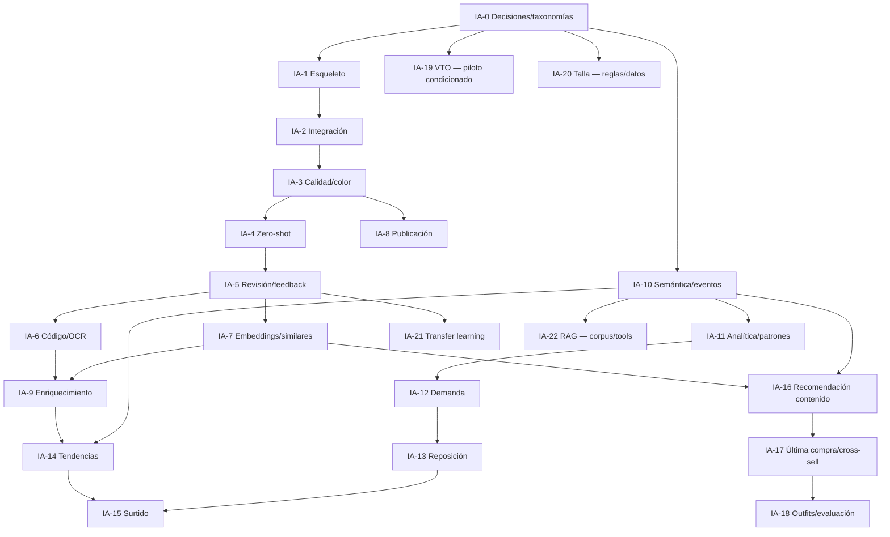

# Roadmap V2

**Estado:** plan de trabajo; ninguna fase está autorizada para implementación por este documento  
**Estimación:** relativa (`XS`, `S`, `M`, `L`, `XL`), no calendario ni compromiso contractual

## 1. Principio de orden

El roadmap ordena primero las capacidades que crean datos confiables y fallback manual. Después habilita decisiones comerciales y recomendación. Virtual try-on, talla aprendida, transfer learning y RAG tienen compuertas independientes: no se desbloquean por haber terminado una fase anterior si licencia, datos, privacidad o hardware siguen pendientes.

## 2. Fases fundacionales y de catálogo

### IA-0 — Decisiones, taxonomías y líneas base

| Campo | Definición |
|---|---|
| Objetivo/valor | fijar qué significa cada categoría, atributo, métrica, riesgo y éxito; evita automatizar inconsistencias |
| Alcance | taxonomías categoría/color/patrón/rol/ocasión; datos permitidos; licencias; baselines; umbrales de abstención; owner |
| Algoritmos/modelos | ninguno; reglas y protocolo de evaluación |
| Entradas/salidas | repositorio/V1/datos → ADRs, taxonomías versionadas, dataset QA y registro de riesgos |
| Dependencias | aprobación negocio, técnica, privacidad y legal |
| Cambios futuros Laravel/FastAPI | ninguno en esta fase; especificaciones para ambos |
| Datos requeridos | muestra representativa de imágenes y definiciones comerciales |
| Dificultad/riesgo | `M`; desacuerdo de taxonomía/licencias |
| Pruebas/aceptación | revisión cruzada, cobertura de catálogo, etiquetas sin ambigüedad crítica; cinco decisiones iniciales aprobadas |
| Entregable/tamaño | ADRs + catálogo de modelos/fuentes + protocolo; **M** |

### IA-1 — Esqueleto FastAPI operable

| Campo | Definición |
|---|---|
| Objetivo/valor | servicio saludable, seguro y observable antes de modelos |
| Alcance | app factory, health/readiness, config, errores, auth interna, logging, tests |
| Algoritmos/modelos | ninguno |
| Entradas/salidas | request interno → sobre común/health |
| Dependencias | IA-0 y aprobación de implementación futura |
| Cambios futuros Laravel/FastAPI | FastAPI: estructura mínima; Laravel: ninguno aún |
| Datos | ninguno comercial |
| Dificultad/riesgo | `S`; secretos/red/observabilidad |
| Pruebas/aceptación | unit/contract/security; servicio sin DB comercial ni descarga runtime |
| Entregable/tamaño | microservicio mínimo desplegable; **S** |

### IA-2 — Integración Laravel–FastAPI y fallback

| Campo | Definición |
|---|---|
| Objetivo/valor | canal privado tolerante a fallos sin bloquear operación manual |
| Alcance | cliente HTTP, token, timeout/retry acotado, request ID, circuit breaker, feature flag |
| Algoritmos/modelos | ninguno |
| Entradas/salidas | solicitud Laravel → respuesta/partial/error normalizado |
| Dependencias | IA-1, red interna y secrets |
| Cambios futuros | Laravel: MatiAiClient/orquestación; FastAPI: auth/contract |
| Datos | casos sintéticos, sin PII |
| Dificultad/riesgo | `M`; retry duplicado, exposición de servicio |
| Pruebas/aceptación | timeout, caída, respuesta inválida, idempotencia; alta manual siempre funciona |
| Entregable/tamaño | integración en shadow; **M** |

### IA-3 — Validación, calidad, duplicado exacto y color

| Campo | Definición |
|---|---|
| Objetivo/valor | reducir imágenes defectuosas/duplicadas y acelerar color |
| Alcance | MIME real, decode, dimensiones, EXIF/orientación, blur/exposición/contraste/fondo, SHA/perceptual hash, color |
| Algoritmos/modelos | visión clásica, histogramas, K-Means acotado |
| Entradas/salidas | portada → observaciones, warnings, paleta y aptitud |
| Dependencias | IA-2, protocolo de imágenes IA-0 |
| Cambios futuros | Laravel: UI de sugerencias/feedback; FastAPI: pipeline CPU |
| Datos | imágenes locales etiquetadas apta/no apta |
| Dificultad/riesgo | `M`; umbrales/cambio de color por iluminación |
| Pruebas/aceptación | corpus adversarial, precisión por warning, pares duplicados; no altera original |
| Entregable/tamaño | análisis ligero con fallback; **M** |

### IA-4 — Clasificación zero-shot

| Campo | Definición |
|---|---|
| Objetivo/valor | top-3 de categoría/atributos para reducir tipeo |
| Alcance | prompts, taxonomía, SigLIP candidato, CLIP baseline, confianza/abstención |
| Algoritmos/modelos | Vision Transformer multimodal zero-shot |
| Entradas/salidas | copia de análisis → top-k, scores, modelo y advertencias |
| Dependencias | IA-3, taxonomía/dataset QA y GPU profile |
| Cambios futuros | Laravel: selección editable; FastAPI: model registry/worker GPU |
| Datos | set bloqueado por clase con casos `otro` |
| Dificultad/riesgo | `L`; sesgo de dominio/idioma y 8 GB |
| Pruebas/aceptación | macro-F1/top-3/calibración/latencia contra CLIP; abstención funciona |
| Entregable/tamaño | classifier en shadow/candidate; **L** |

### IA-5 — Validación humana y feedback

| Campo | Definición |
|---|---|
| Objetivo/valor | convertir sugerencias en dataset confiable sin confundir verdad/predicción |
| Alcance | aceptar/corregir/rechazar, razón, versión, auditoría y dataset exportable |
| Algoritmos/modelos | ninguno |
| Entradas/salidas | sugerencias → confirmación separada + métricas |
| Dependencias | IA-3/4 y contrato de datos |
| Cambios futuros | Laravel: UI/tablas/autoría; FastAPI: sin escritura comercial |
| Datos | usuario revisor y reason codes mínimos |
| Dificultad/riesgo | `M`; click-through sin revisión real/sesgo de anotador |
| Pruebas/aceptación | predicción inmutable, corrección auditada, rollback; cobertura de feedback aprobada |
| Entregable/tamaño | loop humano medible; **M** |

### IA-6 — Barcode, QR y OCR básico

| Campo | Definición |
|---|---|
| Objetivo/valor | identificar antes de transcribir y extraer etiquetas como candidatos |
| Alcance | OpenCV, checksum, búsqueda interna, fotos de etiqueta, Tesseract baseline y normalización |
| Algoritmos/modelos | decoder 1D/2D, OCR, fuzzy matching y reglas |
| Entradas/salidas | captura código/etiqueta → estado/campos/candidatos |
| Dependencias | IA-2/5 y decisión sobre identificadores tipados |
| Cambios futuros | Laravel: capturas dedicadas, búsqueda/confirmación; FastAPI: pipelines separados |
| Datos | códigos/etiquetas reales con verdad; catálogos marca/talla |
| Dificultad/riesgo | `L`; baja calidad/conflictos/códigos de proveedor |
| Pruebas/aceptación | exactitud por simbología/campo, checksum y no creación automática |
| Entregable/tamaño | identificación asistida; **L** |

### IA-7 — Embeddings, duplicado visual y similares internos

| Campo | Definición |
|---|---|
| Objetivo/valor | detectar casi duplicados y encontrar catálogo similar |
| Alcance | embedding versionado, coseno, búsqueda exacta, top-k y filtros |
| Algoritmos/modelos | SigLIP/CLIP embedding, KNN exacto |
| Entradas/salidas | activo aprobado → vector + vecinos/evidencia |
| Dependencias | IA-4/5; activo/taxonomía confiables |
| Cambios futuros | Laravel: persistencia/reindex y UI; FastAPI: embedding/ranking |
| Datos | pares similares/no similares evaluados |
| Dificultad/riesgo | `M`; mezcla de versiones/falsos duplicados |
| Pruebas/aceptación | precision@k, búsqueda exacta reproducible, aislamiento por model version |
| Entregable/tamaño | similitud interna; **M** |

### IA-8 — Preparación de imágenes para publicación

| Campo | Definición |
|---|---|
| Objetivo/valor | derivados consistentes, ligeros, trazables y fieles |
| Alcance | orientación, sRGB, EXIF, recorte conservador, resize, WebP/AVIF evaluado, hashes y manifiesto |
| Algoritmos/modelos | procesamiento determinista; sin generación inicial |
| Entradas/salidas | activo aprobado → thumbnail/card/detail |
| Dependencias | IA-3, política de storage/derechos |
| Cambios futuros | Laravel: lifecycle/derivados; FastAPI/worker: transformaciones |
| Datos | perfiles y navegadores objetivo |
| Dificultad/riesgo | `M`; fidelidad/color/cache |
| Pruebas/aceptación | comparación visual, tamaños, hashes, idempotencia, original intacto |
| Entregable/tamaño | pipeline publication-v1; **M** |

### IA-9 — Enriquecimiento externo controlado

| Campo | Definición |
|---|---|
| Objetivo/valor | encontrar candidatos de proveedor/marca sin publicación automática |
| Alcance | puertos, primer feed/API/manual, safe fetch, ranking y derechos; scraping solo autorizado |
| Algoritmos/modelos | matching código/texto/embedding |
| Entradas/salidas | código/texto/foto → candidatos normalizados/evidencia |
| Dependencias | IA-6/7/8, fuente/permiso y SSRF controls |
| Cambios futuros | Laravel: jobs/revisión/derechos; FastAPI: adaptador/ranking |
| Datos | acceso proveedor o fixtures autorizadas |
| Dificultad/riesgo | `XL`; términos, cambios HTML, derechos, bloqueo |
| Pruebas/aceptación | adapter contract, rate/backoff, SSRF, fuente visible y no autopublicación |
| Entregable/tamaño | un adaptador de alto valor + manual fallback; **XL** |

## 3. Fases de datos e inteligencia comercial

### IA-10 — Semántica analítica e instrumentación

| Campo | Definición |
|---|---|
| Objetivo/valor | crear hechos confiables y registrar exposición/outcomes desde temprano |
| Alcance | venta válida, stockout, períodos, eventos vista/búsqueda/impresión/clic, calidad |
| Algoritmos/modelos | SQL/reglas; ninguno entrenado |
| Entradas/salidas | transacciones/eventos → snapshots/vistas conceptuales y diccionario |
| Dependencias | IA-0 y revisión privacidad |
| Cambios futuros | Laravel/React: instrumentación; FastAPI: contratos snapshot, sin tracking directo |
| Datos | estados, calendario, consent/purpose |
| Dificultad/riesgo | `L`; semántica incorrecta/doble conteo |
| Pruebas/aceptación | reconciliación, idempotencia, bots/tests marcados, impresión visible definida |
| Entregable/tamaño | data contract comercial; **L** |

### IA-11 — Analítica y patrones

| Campo | Definición |
|---|---|
| Objetivo/valor | explicar ventas, inactividad, rotación, reservas y cestas |
| Alcance | indicadores, RFM por reglas, asociación solo si soporte, anomalías por reglas |
| Algoritmos/modelos | SQL, estadística, Apriori/FP-Growth futuro |
| Entradas/salidas | snapshot → indicadores/patrones/advertencias |
| Dependencias | IA-10 |
| Cambios futuros | Laravel: reportes/snapshots; FastAPI: batch analítico opcional |
| Datos | historia suficiente y clientes/cestas para módulos avanzados |
| Dificultad/riesgo | `M`; asociaciones espurias |
| Pruebas/aceptación | fórmula reproducible, soporte absoluto, filtros temporales; baseline descriptivo correcto |
| Entregable/tamaño | analítica-v2 y patrón con compuerta; **M** |

### IA-12 — Pronóstico de demanda

| Campo | Definición |
|---|---|
| Objetivo/valor | rangos de demanda por horizonte con honestidad sobre historia |
| Alcance | elegibilidad, naive/móvil, Croston/ETS según régimen, jerarquía y backtesting |
| Algoritmos/modelos | baselines/series; deep excluido inicialmente |
| Entradas/salidas | series+cutoff+stockouts → forecast/intervalo/evaluación o abstención |
| Dependencias | IA-10/11 y varios cortes temporales |
| Cambios futuros | Laravel: snapshots/persistencia/UI; FastAPI: forecast/evaluation batch |
| Datos | historia, stockouts, promociones, precio, calendario |
| Dificultad/riesgo | `L`; datos actuales insuficientes/leakage |
| Pruebas/aceptación | rolling backtest, WAPE/MASE/sesgo/cobertura vs naive; `insufficient_history` hoy |
| Entregable/tamaño | champion baseline en shadow; **L** |

### IA-13 — Reposición y abastecimiento

| Campo | Definición |
|---|---|
| Objetivo/valor | sugerir fecha/cantidad sin comprar automáticamente |
| Alcance | posición, cobertura, ROP, min-max, stock seguridad; EOQ solo con costos |
| Algoritmos/modelos | reglas/investigación operativa/simulación futura |
| Entradas/salidas | forecast+stock+lead time+restricciones → rango/riesgo/faltantes |
| Dependencias | IA-12 y maestros de proveedor/suministro |
| Cambios futuros | Laravel: proveedores/pedidos/revisión; FastAPI: cálculo puro |
| Datos | lead time, mínimos, costos, tránsito hoy ausentes |
| Dificultad/riesgo | `L`; datos inventados/supuestos EOQ |
| Pruebas/aceptación | escenarios y unidades, no doble reserva, explicación; abstiene si faltan críticos |
| Entregable/tamaño | reposición asistida; **L** |

### IA-14 — Tendencias externas

| Campo | Definición |
|---|---|
| Objetivo/valor | observar señales propias/proveedor/públicas permitidas con resiliencia |
| Alcance | Instagram propio, fuente proveedor/manual; Pinterest/Google condicionados; score explicable |
| Algoritmos/modelos | normalización, texto/visión, series y reglas |
| Entradas/salidas | observaciones externas+internas → trend/alignment/risk/action |
| Dependencias | IA-9/10, accesos y taxonomía |
| Cambios futuros | Laravel: jobs/fuentes/evidencia; FastAPI: adapters/scoring |
| Datos | cuenta profesional/permisos/importaciones |
| Dificultad/riesgo | `XL`; API alpha/restringida/terms |
| Pruebas/aceptación | fuente ausente no rompe; escala/frescura visibles; no Instagram scraping |
| Entregable/tamaño | un adapter autorizado + manual fallback; **XL** |

### IA-15 — Inteligencia de surtido

| Campo | Definición |
|---|---|
| Objetivo/valor | proponer nuevos productos/variantes mediante lote piloto |
| Alcance | gaps, tendencia, demanda no satisfecha, economía, proveedor y riesgo |
| Algoritmos/modelos | ranking multicriterio; LTR futuro |
| Entradas/salidas | snapshots → oportunidad/evidencia/lote/confianza |
| Dependencias | IA-11/13/14 y proveedor/presupuesto |
| Cambios futuros | Laravel: revisión/outcome; FastAPI: scoring |
| Datos | búsquedas sin resultado, márgenes, catálogo proveedor, capacidad |
| Dificultad/riesgo | `L`; confundir popularidad con demanda |
| Pruebas/aceptación | evidencia por componente, missing no=0, piloto evaluable y no auto-compra |
| Entregable/tamaño | surtido-v1 en shadow; **L** |

## 4. Fases de recomendación

### IA-16 — Recomendación por contenido

| Campo | Definición |
|---|---|
| Objetivo/valor | similares/novedades útiles para anónimo y cold start |
| Alcance | candidatos, filtros, ranking, diversidad, fallback y reason codes |
| Algoritmos/modelos | reglas, popularidad acotada, embeddings/KNN exacto |
| Entradas/salidas | contexto+catálogo → ranking explicable |
| Dependencias | IA-7/10 y stock fiable |
| Cambios futuros | Laravel: endpoint/UI/log impresión; FastAPI: ranker |
| Datos | atributos/embedding y eventos para evaluar |
| Dificultad/riesgo | `M`; bucle de popularidad/exposición |
| Pruebas/aceptación | precision@k, cobertura/diversidad, stock y fallback |
| Entregable/tamaño | similares de producto; **M** |

### IA-17 — Última compra y cross-selling

| Campo | Definición |
|---|---|
| Objetivo/valor | aumentar utilidad/cesta con complementos relevantes |
| Alcance | ventana última compra, matriz de roles, asociación futura |
| Algoritmos/modelos | reglas+contenido; FP-Growth tras compuerta |
| Entradas/salidas | compra/items → complementos+razones |
| Dependencias | IA-10/16, clientes identificados y roles |
| Cambios futuros | Laravel: contexto mínimo/impresiones; FastAPI: ranking |
| Datos | hoy insuficientes para secuencias/asociación |
| Dificultad/riesgo | `M`; privacidad y reglas anecdóticas |
| Pruebas/aceptación | anulación/antigüedad, rol, stock; no historia completa a FastAPI |
| Entregable/tamaño | cross-sell por reglas; **M** |

### IA-18 — Outfits, perfiles y evaluación online

| Campo | Definición |
|---|---|
| Objetivo/valor | conjuntos completos y mejora medible sin falsa personalización |
| Alcance | plantillas, compatibilidad, presupuesto, perfil contenido, A/B futuro |
| Algoritmos/modelos | reglas, ranking, beam search; LTR futuro |
| Entradas/salidas | anchor/ocasión/perfil mínimo → outfits + explicaciones |
| Dependencias | IA-10/16/17, taxonomías y tráfico |
| Cambios futuros | Laravel/React: feedback/experimentos; FastAPI: outfit ranker |
| Datos | estilo/ocasión/silueta y eventos; hoy ausentes |
| Dificultad/riesgo | `L`; combinatoria/sesgo/optimizar CTR |
| Pruebas/aceptación | constraints, diversidad, evaluación experta/offline y guardrails online |
| Entregable/tamaño | outfits-v1; **L** |

## 5. Fases avanzadas independientes

### IA-19 — Virtual try-on

| Campo | Definición |
|---|---|
| Objetivo/valor | visualización sintética opcional y privada |
| Alcance | consentimiento, job, worker exclusivo, watermark, TTL/borrado y candidato licenciado |
| Algoritmos/modelos | FASHN VTON v1.5 solo candidato de spike; modelos NC bloqueados |
| Entradas/salidas | foto+activo aprobado → imagen temporal/warnings |
| Dependencias | licencia, privacidad, hardware benchmark y cola |
| Cambios futuros | Laravel: consentimiento/jobs/storage; FastAPI: worker VTO aislado |
| Datos | voluntarios adultos/activos autorizados |
| Dificultad/riesgo | `XL`; licencia, 8 GB, artefactos, imagen personal |
| Pruebas/aceptación | VRAM/latencia/fidelidad/OOM/borrado/abuso; no afirma talla |
| Entregable/tamaño | piloto cerrado, no lanzamiento automático; **XL** |

### IA-20 — Talla y ajuste

| Campo | Definición |
|---|---|
| Objetivo/valor | reducir incertidumbre/devolución con tablas y medidas |
| Alcance | tablas por marca/prenda, medidas, fit preference, reglas; probabilístico futuro |
| Algoritmos/modelos | reglas/ranking; clasificación calibrada después |
| Entradas/salidas | tabla+prenda+perfil → tallas/rango/abstención |
| Dependencias | gobernanza de medidas y datos hoy ausentes; no depende de VTO |
| Cambios futuros | Laravel: maestros/perfil/consent; FastAPI: regla pura |
| Datos | tablas, medidas de prenda y feedback |
| Dificultad/riesgo | `L`; medición/unidades/privacidad |
| Pruebas/aceptación | casos por corte/material, abstención, top-2/calibración futura vs tabla |
| Entregable/tamaño | sizing por reglas; **L** |

### IA-21 — Transfer learning

| Campo | Definición |
|---|---|
| Objetivo/valor | superar zero-shot en taxonomía propia solo con evidencia |
| Alcance | dataset versionado, dedupe/split, ResNet/EfficientNet/ConvNeXt, registry/rollback |
| Algoritmos/modelos | CNN/convolucional moderna; fine-tuning |
| Entradas/salidas | imágenes+labels → modelo candidato/model card |
| Dependencias | IA-5, volumen/diversidad y GPU offline |
| Cambios futuros | Laravel: export aprobación; training separado; FastAPI: solo inferencia aprobada |
| Datos | suficiente por clase/producto; criterio a definir en IA-0 |
| Dificultad/riesgo | `XL`; overfit/licencia/leakage |
| Pruebas/aceptación | test bloqueado por producto, macro-F1/calibración/latencia vs SigLIP |
| Entregable/tamaño | challenger, no activación automática; **XL** |

### IA-22 — RAG/asistente empresarial

| Campo | Definición |
|---|---|
| Objetivo/valor | consultar políticas, fichas y reportes con citas y tools limitadas |
| Alcance | corpus autorizado, retrieval, filtros de acceso, citas, solo lectura y abstención |
| Algoritmos/modelos | búsqueda léxica/vectorial + LLM aprobado |
| Entradas/salidas | pregunta+permisos → respuesta citada o abstención |
| Dependencias | corpus/versiones, IAM, contratos de tools y evaluación |
| Cambios futuros | Laravel: auth/tools/auditoría; FastAPI/RAG: retrieval/guardrails |
| Datos | documentación curada; no dump indiscriminado DB |
| Dificultad/riesgo | `XL`; alucinación, permisos, frescura y costo |
| Pruebas/aceptación | groundedness/citas, denegación, prompt injection y cero mutaciones |
| Entregable/tamaño | piloto interno read-only; **XL** |

## 6. Paralelismo permitido

Después de IA-0–IA-2:

- **Pista catálogo:** IA-3 → IA-4/5 → IA-6/7; IA-8 puede avanzar desde IA-3; IA-9 espera identificación/similitud.
- **Pista datos:** IA-10 puede iniciar en paralelo con IA-3; no necesita modelos.
- **Pista comercial:** IA-11 tras semántica; IA-12 espera historia; IA-13 puede diseñar maestros mientras espera forecast.
- **Pista externa:** evaluar permisos de IA-9/14 temprano, pero implementar adapter solo tras aprobación.
- **Pista recomendación:** IA-16 usa IA-7+IA-10; matriz de roles de IA-17/18 puede curarse en IA-0.
- **Pista talla:** recopilar tablas/medidas de prenda en paralelo; no requiere VTO.
- **Pista VTO:** auditoría legal/hardware puede ser spike aislado, sin bloquear MVP1–4.
- **Transfer/RAG:** preparar criterios/corpus; ejecutar solo al cumplir compuertas.

Una pista no comparte edición simultánea de contratos/tablas sin owner y versión coordinada.

## 7. MVPs corregidos

### MVP 1 — Alta visual asistida

**Incluye:** IA-0–IA-5: validación, calidad, color, top-3 categoría, abstención y validación humana.  
**Valor:** menos reproceso y registro más rápido; genera dataset propio.  
**Excluye:** búsqueda externa, autoedición, detector complejo y entrenamiento.

### MVP 2 — Identidad y publicación confiable

**Incluye:** IA-6–IA-9: código/OCR, búsqueda interna, duplicados, derivados y un enrichment autorizado/manual.  
**Valor:** evita duplicados/transcripción y mejora activos.  
**Corrección:** enriquecimiento externo no entra si no hay fuente/derechos; el MVP sigue siendo válido con proveedor/manual.

### MVP 3 — Descubrimiento y cross-sell por reglas

**Incluye:** IA-10, IA-16–IA-18 en alcance inicial: eventos, similares, última compra si existe, matriz de complementos y outfits curados.  
**Valor:** descubrimiento desde cold start y base de evaluación.  
**Excluye:** colaborativo, LTR y claims de personalización fuerte.

### MVP 4A — Analítica confiable

**Incluye:** IA-11 y semántica IA-10.  
**Valor:** decisiones descriptivas reproducibles ahora.  
**Motivo de separación:** no esperar meses de historia para entregar indicadores correctos.

### MVP 4B — Demanda, reposición, tendencias y surtido condicionados

**Incluye:** IA-12–IA-15 cuando existan historia, proveedor, stockout y acceso a fuentes.  
**Valor:** escenarios/rangos y lotes piloto.  
**Corrección:** si faltan datos, permanece en shadow/`insufficient_history`; no se fuerza un producto predictivo.

### MVP 5 — Pilotos avanzados independientes

- **Talla por reglas** puede salir antes que VTO si hay tablas/medidas.
- **VTO** es un piloto separado sujeto a licencia, privacidad y 8 GB.
- **Transfer learning** depende del dataset, no de VTO/talla.
- **RAG** depende del corpus/permisos, no de terminar los modelos visuales.

No deben empaquetarse como un único lanzamiento.

## 8. Primer MVP recomendado

MVP 1 es el primero. Su slice vertical mínimo:

1. contrato y fallback Laravel–FastAPI;
2. MIME/dimensiones/orientación/hash/calidad;
3. color con advertencia de fondo;
4. top-3 de una taxonomía pequeña, SigLIP candidato y CLIP baseline offline;
5. UI de aceptar/corregir/rechazar;
6. predicción y verdad separadas;
7. métricas de latencia, cobertura, corrección y error.

Criterio de éxito comercial: reduce tiempo/retrabajo de alta sin elevar errores confirmados y sin bloquear el flujo manual.

## 9. Compuertas globales de avance

Cada fase requiere:

- owner de negocio/técnico;
- contrato y taxonomía versionados;
- fuente/licencia/privacidad aprobadas;
- dataset o fixtures representativos;
- baseline y métrica primaria;
- pruebas de fallback/seguridad;
- observabilidad/costo;
- criterio de rollback y desactivación;
- revisión humana para efecto comercial;
- post-evaluación del valor entregado.

Completar código no equivale a completar la fase si los criterios de aceptación no se cumplen.
